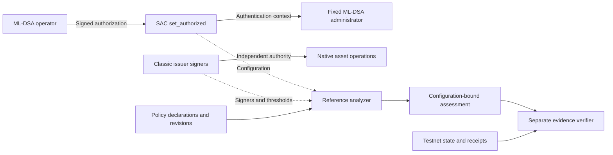

# Q-Asset

**Verifiable Post-Quantum Authority for Stellar Assets and Treasuries**

Q-Asset develops Rust and Soroban infrastructure for analyzing and strengthening
the authorization controlling Stellar assets and institutional treasuries against
quantum-era threats. Its focus is effective authority: which accounts, signers
and contracts can issue tokens, change holder permissions, move treasury assets
or replace the rules governing those operations.

A post-quantum signature can protect one operation while a classical issuer,
administrator or alternative smart-account rule retains an independent route to
the same authority. Q-Asset maps supported authorization paths, identifies those
classical-key bypasses, integrates stronger approval rules where authority can
be delegated, and produces reproducible evidence of the resulting coverage.

The current Stellar Testnet PoC implements this approach for two synthetic assets
and one SAC administrative operation. Broader issuer, custody and treasury
integrations are part of the engineering roadmap.

> **Status: Experimental Stellar Testnet infrastructure. The current PoC
> demonstrates scoped ML-DSA authorization and authority-path assessments. It has
> not undergone an independent external security audit and is not intended for
> production custody.**

[Current PoC](#current-proof-of-concept) · [Verified results](#verified-poc-results) ·
[Reproduce](#reproduce-the-poc) · [Source and evidence](#source-and-evidence) ·
[Security scope](#security-scope-and-limitations)

## Why Post-Quantum Signatures Alone Are Not Enough

A sufficiently capable quantum computer would threaten the discrete-log
assumptions behind Ed25519, which Stellar uses for transaction signatures.
ML-DSA is a post-quantum signature algorithm standardized in
[NIST FIPS 204](https://csrc.nist.gov/pubs/fips/204/final).

**Cryptographic protection** means an operation requires a signature designed to
resist quantum adversaries. **Effective authority protection** also requires
every relevant route capable of authorizing that operation to be controlled.

For example, an issuer can delegate its Stellar Asset Contract (SAC)
administration to an ML-DSA-protected smart account. The original classic issuer
may still issue additional tokens through a native Stellar `Payment`. SAC
administration and issuer signing permissions operate independently, as
documented in Stellar's [custom SAC administrator guide](https://developers.stellar.org/docs/build/guides/tokens/custom-sac-admin).
This is an authorization-coverage problem, independent of the signature
algorithm's correctness.

The same reasoning applies to treasury signers, contract upgrade keys,
governance, emergency administration, recovery permissions and alternative
smart-account rules. A classical key that can replace a stronger policy is
itself a sensitive authority path. Q-Asset's analysis is limited to explicitly
supported configurations; arbitrary Soroban bytecode requires additional
integration models and review.

## How Q-Asset Works

The architecture combines four capabilities. The reference implementation
demonstrates their interaction within a deliberately bounded configuration.

### Authority-Path Analysis

Identify who can authorize sensitive operations and whether classical keys can
satisfy or bypass their approval requirements. Product coverage is intended to
include issuance, holder authorization and freezing, clawback, treasury
transfers, administration, upgrades, governance, signer changes and recovery.
The current analyzer specifically recognizes the recorded QEXP and QCTL
configurations; it reports unsupported operations as uncovered.

### On-Chain Policy Registry

Record tenant-specific roles, signer algorithms and weights, thresholds,
administrator changes and policy revisions. The registry validates weighted
declarations and emits change events. Its declared QS0–QS4 levels describe
policy arithmetic; `policy_assessment` remains `Unverified`, and the verified
security-gate APIs reject. Registering a policy does not establish control over
the named asset or enforce that policy in another contract.

### Post-Quantum Authorization Integrations

Apply operation-specific approval rules through compatible Soroban authentication
and properly delegated asset administration. The current administrator checks
real ML-DSA-65 credentials for the configured SAC's `set_authorized` call.
Q-Asset cannot unilaterally change classic-account permissions. Each additional
asset operation or account policy needs its own supported integration.

### Reproducible Security Assessments

Tie declared policies and tested behavior to network, asset and issuer
identities, signers, thresholds, flags, administrators, executable hashes,
policy revisions and tool-source identity. Assessments distinguish successful
authorization, rejected credentials, exposed classical authority and uncovered
operations. Independent reproduction supports inspection of these claims; it
does not provide universal formal security certification.

## Stellar Integration

**Classic Stellar accounts** use native signer weights and thresholds. Classic
issuers can retain asset powers independently of SAC administration, so their
effective signing configuration must be examined separately.

**Stellar Asset Contracts** expose Stellar assets through the smart-contract
token interface. For issued assets, SAC administration can be delegated to a
compatible account or contract with the current administrator's authorization.
The PoC supports only holder authorization through `set_authorized`; it does
not supply complete SAC administration.

**Soroban smart accounts** provide programmable authentication through
`__check_auth`. When an operation calls `require_auth` for a contract address,
the host uses that contract's authentication rules and the authorization
context. These mechanisms control permissions; they are not a new asset
category. See Stellar's [authorization framework](https://developers.stellar.org/docs/learn/fundamentals/contract-development/authorization).

**Institutional treasury systems** may hold XLM, USDC and other assets through
classic accounts, smart accounts or custody arrangements. Q-Asset's intended
treasury coverage concerns transfer approvals, signer changes and administrative
overrides. Treasury transfers and third-party custody integrations are not
demonstrated by the current SAC PoC.

The design is asset-agnostic, with regulated RWAs and institutional treasuries
as initial use cases. Stablecoins and other issued assets can be covered when
their authority arrangements have an explicit supported model. Asset names
alone do not establish compatibility.

### Protocol 30 and CAP-87

As of **26 October 2026**, Stellar's official [Bell, Protocol 30 upgrade guide](https://stellar.org/blog/developers/bell-protocol-30-upgrade-guide)
schedules the Testnet vote for **3 November 2026** and the Mainnet vote for
**23 November 2026**, subject to validator approval. CAP-87 adds native ML-DSA
verification for smart contracts; it does not replace network transaction
signatures. The official [CAP-87 specification](https://github.com/stellar/stellar-protocol/blob/master/core/cap-0087.md)
describes the cryptographic interface.

**This PoC uses RustCrypto `ml-dsa` 0.1.1 inside contract Wasm, not CAP-87 host
verification.** Its recorded run used Testnet protocol 29. Native verification
is a possible future integration after target-network activation and compatibility
checks. It supplies a cryptographic primitive; authority coverage still needs
to be established.

## What Makes Q-Asset Different?

Q-Asset's contribution is the integration of authority analysis, supported
enforcement and configuration-bound evidence. It combines:

1. Identification of actual account and contract authority paths.
2. Detection of independently usable classical signing routes.
3. Operation-specific post-quantum authentication in supported integrations.
4. Behavioral tests against real Stellar execution.
5. Reproducible assessments with explicit evidence and coverage boundaries.
6. Detection of configuration changes that invalidate an earlier assessment.

Its unit of analysis extends beyond a wallet or individual signature to the
permissions controlling an asset. ML-DSA, multisignature policies, programmable
accounts, SACs and zero-knowledge proofs are existing foundations. No new
signature algorithm or exclusive priority claim is made.

## Use Cases

These are intended applications of the broader architecture, rather than claims
of deployed customer integrations.

| User | Authority problem |
| --- | --- |
| Regulated RWA issuers | Identify classical issuance, holder-control and administration paths over long-lived assets. |
| Stablecoin and token issuers | Compare intended approval policies with issuer and SAC permissions. |
| Institutional treasury operators | Assess transfer rules, signer changes and administrative overrides across supported accounts. |
| Custodians | Track authority configuration, key-management dependencies and changes affecting earlier assessments. |
| Soroban smart-account developers | Test custom authentication and identify weaker fallback or upgrade rules. |
| Security teams and auditors | Reproduce cited behavior and distinguish tested protection from declarations and missing coverage. |

## Current Proof of Concept

The implemented reference workflow uses two synthetic Stellar assets, **QEXP**
and **QCTL**, a separate policy registry, a fresh ML-DSA operator key and one
restricted SAC administrator instance per asset. It demonstrates real signature
verification, authorized administration, classical issuer exposure, restricted
issuer authority and assessment invalidation after a policy change.

| Component | Implemented role |
| --- | --- |
| `qasset-sac-admin` | Fixes one SAC and ML-DSA-65 public key at construction; admits only one direct `set_authorized(holder, authorize)` context. |
| `qasset-registry` | Validates tenant policy declarations, isolates administration and records revisions and events. |
| `qasset-sac-signer` | Generates a fresh operator key outside the repository and signs the standard Soroban authorization payload with the contract's domain context. |
| Authority analyzer | Collects supported live configuration and produces the reference asset-path assessment. |
| Evidence verifier and public cryptographic helper | Independently check input hashes, XDR, credentials, rejection causes and configuration; optionally recheck live code and transaction receipts. |
| Testnet and staleness runners | Create disposable demonstrations and record the policy-revision experiment. |

The administrator checks the complete authorized context before verifying the
signature. Only the configured SAC, function and two-argument invocation are
accepted. Credentials bind the actual arguments and network through the host's
authorization payload; host checks enforce expiration and nonce replay prevention.
Tests reject wrong keys, corrupted signatures, wrong networks and domains,
changed arguments, replay, expiry, other SACs and nested or composite contexts.
Even a valid operator signature cannot authorize `mint` or `set_admin`.

**The SAC administrator does not dynamically consult the registry.** Its fixed
authorization policy and the registry's declarations are separate components.
The guarded `set_role_quorum_if_revision` registry API requires tenant authority
and rejects stale expected revisions without changing policy or emitting a
policy-change event. All declarations in this PoC use it; the legacy
unconditional setter remains available for compatibility.



The registry feeds the assessment workflow. The diagram's separate native issuer
route is the independent authority that SAC-only authentication cannot remove.

## Reference Asset Demonstration

| Property | QEXP: exposed classical authority | QCTL: restricted issuer authority |
| --- | --- | --- |
| SAC holder authorization | Genuine ML-DSA-65 authorization succeeds. | Genuine ML-DSA-65 authorization succeeds. |
| Classic issuer signing authority | Retained; native issuance and trustline-flag changes succeed. | Fresh disposable issuer has no positive-weight signer after its explicitly gated lock. |
| Classic issuer Payment | Native issuance succeeds while issuer signing authority is retained. | Correctly signed Payment is rejected at submission after the lock with `txBAD_AUTH`. |
| Post-lock ML-DSA probe | Not part of this asset's scenario; QEXP stays unlocked. | Protected operation succeeds after the issuer lock. |
| Conclusion | One protected SAC operation coexists with classical authority. | The tested issuer signing path is disabled while the supported SAC operation remains usable. |

The QCTL result is specific to the tested configuration and operation. It does
not establish complete asset protection. Issuer locking is irreversible; the
demonstration permits it only for its own fresh disposable issuer behind an
explicit gate. Advanced execution instructions are in the
[PoC evidence guide](docs/QASSET_POC_EVIDENCE.md).

## Verified PoC Results

The [25 October 2026 validation record](evidence/qasset-remediation-validation.json)
and [clean reproduction log](evidence/qasset-clean-reproduction.json) record
**218 passing automated tests**, builds of all **five contracts**, and matching
hashes for the two reference Wasm artifacts. The tests span **90 contract tests,
4 signer tests and 124 Python tests**, including recovery and research coverage.
The SAC administrator accounts for **21** of the contract tests. The public
credential helper has no standalone unit tests; evidence tests exercise its
real credential verification.

The [deployment record](deployments/testnet/qasset-poc.json) separately contains
**28 included successful transactions**, **10 rejected enforced simulations**
and **one `txBAD_AUTH` submission rejection**. The negative simulations and
rejected submission are not included failed transactions.

The [schema-v2 assessment](evidence/qasset-authority-assessment.json), produced by
assessment tool **2.0.0**, classifies **32 authority paths** across two assets:

| Status | Count | Meaning within this assessment |
| --- | ---: | --- |
| `EXPOSED` | 5 | Supported configuration or successful execution establishes usable classical authority. |
| `TESTED_PASS` | 4 | The cited authorized operation succeeds. |
| `TESTED_REJECT` | 11 | The cited operation or credential rejects under its documented conditions. |
| `UNCOVERED` | 10 | The path has no established tested protection in this assessment. |
| `DECLARED` | 2 | A policy is recorded without established enforcement. |
| **Total** | **32** | Classifications, not 32 independently protected operations or an overall security score. |

Reference artifact SHA-256 values:

```text
qasset_sac_admin.wasm  59,167 bytes
f7ed9b81ca062af1b52c793fa068d43220d900c0d572e648f6e2d0f5a2a472b6

qasset_registry.wasm   28,553 bytes
26f684edb7e3255ac1617f1455fbfcf886a0f5b189f31974b873a5bc0f98a207
```

Recorded Testnet transactions:

- [QCTL disposable issuer lock](https://stellar.expert/explorer/testnet/tx/2e2339e33b1a18f21a32d68298c0251929bbf4875980053ad8476a61b84f63d9).
- [QCTL ML-DSA authorization after the lock](https://stellar.expert/explorer/testnet/tx/65645f25f02699c3bedb60b5fd73fed8ea76ec954b316dab7ed35e90915d3f42).
- [QEXP guarded policy revision change](https://stellar.expert/explorer/testnet/tx/4453b55e47b3cc530c0215d59cd4ab81a211cafcd71854f86d15a32af6e626e1).

These links identify receipts in the recorded run. Testnet resets, archival and
configuration changes can affect their later availability and relevance.

### Assessment Freshness

The [staleness experiment](evidence/qasset-poc-staleness.json) advanced QEXP's
policy revision from **3 to 4** while QCTL remained at **3**. Verification of the
preserved earlier assessment marked exactly **16 QEXP paths `STALE`** and exited
with code 1. The refreshed assessment passed the recorded live checks across
all 32 paths and rechecked 28 successful receipts. The
[stale result](evidence/qasset-remediation-stale-verification.json) and
[refreshed result](evidence/qasset-remediation-live-verification.json) preserve
both outcomes.

The verifier also checks executable, administrator, signer, threshold and other
supported configuration changes. Evidence is tied to the configuration examined;
a historical pass does not establish present-day freshness.

## Reproduce the PoC

Reference environment: **Linux x86_64, Python 3.10, Rust 1.94.1** and the
**`wasm32v1-none`** target. The signer uses Unix filesystem protections.
Cargo dependencies are locked, and the Python lockfile pins versions and wheel
hashes for this reference environment.
The pins reproduce the recorded protocol-29 workflow. Revalidate SDK and XDR
compatibility before using live checks against later protocol upgrades.

From the repository root:

```bash
rustup toolchain install 1.94.1
rustup target add wasm32v1-none --toolchain 1.94.1

python3 -m venv /tmp/qasset-poc-env
/tmp/qasset-poc-env/bin/python -m pip install \
  --require-hashes -r scripts/requirements-poc.lock

RUSTUP_TOOLCHAIN=1.94.1 /tmp/qasset-poc-env/bin/python scripts/reproduce_poc.py
```

Install Python's venv support if your distribution packages it separately. The
[evidence guide](docs/QASSET_POC_EVIDENCE.md#reproduce-from-a-clean-checkout)
also documents provisioning an isolated environment when `ensurepip` is absent.

The runner builds the five contracts and two PoC tools, executes automated tests,
compares reference Wasm hashes, verifies offline assessment consistency and
checks retained research records and a public proof-transport fixture. It does
not submit transactions, disable issuer accounts or generate a new recovery
proof. Optional ignored research artifacts can be reported as absent; source
and record checks do not establish fresh proof execution.

Add `--offline` when Cargo dependencies are cached. For optional **read-only live
verification**, add `--live`:

```bash
RUSTUP_TOOLCHAIN=1.94.1 /tmp/qasset-poc-env/bin/python scripts/reproduce_poc.py --live
```

After the build, the evidence verifier can also run separately:

```bash
/tmp/qasset-poc-env/bin/python scripts/verify_qasset_evidence.py --offline
/tmp/qasset-poc-env/bin/python scripts/verify_qasset_evidence.py
```

Offline mode establishes recorded consistency only. Live mode additionally
rechecks available Testnet receipts, code and supported configuration. Verifier
exit 0 means `SUCCESS`; exit 1 means `STALE` or `INVALID`, distinguished by its
JSON status; exit 2 means `INCONCLUSIVE` because required live evidence is
unavailable. The reproduction runner expects the preserved pre-change assessment
to fail its live freshness check.

## Source and Evidence

| Area | Entry points |
| --- | --- |
| Contract enforcement | [SAC administrator](contracts/qasset-sac-admin/src/lib.rs) · [21 adversarial tests](contracts/qasset-sac-admin/src/test.rs) |
| Declared policy | [Registry](contracts/qasset-registry/src/lib.rs) · [registry tests](contracts/qasset-registry/src/test.rs) |
| Operator credentials | [Fresh-key signer](tools/qasset-sac-signer/src/main.rs) · [public verification helper](tools/qasset-evidence-crypto/src/main.rs) |
| Assessment and verification | [Analyzer](scripts/qasset_authority_analyzer.py) · [separate verifier](scripts/verify_qasset_evidence.py) · [tamper regressions](scripts/test_qasset_evidence.py) |
| Reproduction and Testnet scenarios | [Reproduction runner](scripts/reproduce_poc.py) · [disposable demo](scripts/qasset_poc_testnet.py) · [staleness runner](scripts/qasset_poc_staleness.py) |
| Public inputs and claims | [Deployment](deployments/testnet/qasset-poc.json) · [raw snapshot](evidence/qasset-authority-inputs.json) · [assessment](evidence/qasset-authority-assessment.json) |
| Results and review boundaries | [Validation](evidence/qasset-remediation-validation.json) · [full reproduction output](evidence/qasset-clean-reproduction.json) · [security findings](docs/POC_SECURITY_FINDINGS.md) |
| Detailed architecture | [Authority architecture](docs/POC_ARCHITECTURE.md) · [threat model](docs/POC_THREAT_MODEL.md) · [evidence guide](docs/QASSET_POC_EVIDENCE.md) |

## Experimental Recovery Research

Recovery is a separate advanced research direction. It explores enrolled ML-DSA
authority replacement, legacy SEP-5 seed-knowledge proofs, Binius64 verifier
portability, RoKoko lattice-based constraint experiments and Soroban execution
limits.

The [ML-DSA recovery candidate](contracts/pq-recovery-demo/src/lib.rs) was narrowed
after an authorization-caching flaw was reproduced in an earlier version. The
corrected source restricts authentication to its own protected counter. Its
redeployment is not established by the retained evidence; old recovery receipts
describe the pre-fix deployment. Its published fixture keys are known to
everyone and must never hold funds. These warnings concern the separate recovery
demo, not the fresh-key SAC administrator demonstration.

The [legacy-seed verifier interface](contracts/seed-recovery-verifier/src/lib.rs)
remains disabled: `backend_available()` is false and authorization fails. Earlier
proof experiments include insecure reduced-round or otherwise unvalidated
settings. The [proof mailbox](contracts/recovery-proof-mailbox/src/lib.rs) stores
sealed **unverified** bytes; successful upload does not validate seed knowledge
or change account authority.

Binius64 experiments include a 539,888-byte canonical proof and a 127,068-byte
raw Wasm verifier. The recorded 183,090-byte SDK wrapper remains oversized and
exhausts the measured 400M instruction budget. RoKoko work includes corrected
arithmetic gadgets and targeted adversarial tests, rather than a complete
reviewed SHA-512 recovery relation. Quantum soundness, privacy, execution
feasibility and the complete recovery lifecycle remain unresolved.

Some research variants expose a scalar that is a working classical signing
secret. Every effective classical or reused-key authority must be retired with
finality before any disclosure, including disclosure to an RPC or proving
service. These public-fixture experiments do not establish that migration for
live accounts.

See [recovery status](docs/RECOVERY_IMPLEMENTATION_STATUS.md),
[recovery security review](docs/SECURITY_REVIEW.md),
[Binius evidence](docs/BINIUS_RECOVERY_EVIDENCE.md),
[successor verifier evidence](docs/VERIFIER_NEXT_EVIDENCE.md) and
[RoKoko scope and corrections](docs/ROKOKO_RELATION_WIRING_SCOPE.md).

## Roadmap

The following capabilities extend beyond the current reference PoC:

- **Expanded authority analysis:** explicit adapters for additional issuer,
  asset, treasury and smart-account configurations, including unsupported-path
  reporting and broader critical-operation coverage.
- **Reusable post-quantum enforcement:** more operation-specific policies,
  multiple signers and thresholds, secure key management and carefully controlled
  administration; evaluate native ML-DSA verification after network activation.
- **Security evidence and monitoring:** versioned assessment interfaces,
  configuration change detection, historical comparison and independently
  verifiable attestations with defined trust and freshness models.
- **Institutional integration:** developer interfaces, SDKs, reference treasury
  and custody integrations, operational documentation and reviewed deployment
  procedures.
- **Recovery research:** independent proof-system review, measured verifier
  feasibility and safe migration with prior enrollment, current eligibility,
  revocation, replacement possession and atomic one-time recovery.

Broader authority analysis and enforcement can develop independently of the
recovery research outcome.

## Security Scope and Limitations

- **Coverage is explicit.** The administrator admits only the configured SAC's
  `set_authorized` operation. Tested rejections do not establish protection for
  every asset, treasury or administrative action.
- **Native issuer authority is separate.** Delegating SAC administration does
  not remove classic issuer signing powers. The PoC does not unilaterally change
  other issuers or establish complete asset-wide quantum safety.
- **Declarations are not enforcement.** The registry's policy assessments remain
  `Unverified`. Its registrar and tenant administration remain classical in this
  demonstration.
- **Cryptographic integration is unaudited.** RustCrypto `ml-dsa` 0.1.1 and the
  reference contracts have not completed independent external security review.
  Standardization of ML-DSA does not certify this implementation.
- **Transaction infrastructure remains classical.** Sources and fee payers sign
  Ed25519 transaction envelopes. Their authority is distinct from the protected
  contract credential; the PoC is not a network-wide signature migration.
- **Key and storage lifecycle is limited.** The SAC administrator has no upgrade,
  key rotation or recovery entry point. Operator-key loss can make administration
  unavailable. Bounded instance leases and restoration require operational
  maintenance.
- **Evidence has provenance limits.** Checksums are not signed attestations.
  Historical negative RPC responses remain transcripts, although their actual
  credential semantics and expected diagnostics are checked. Generator timestamps
  are untrusted metadata; raw read ledgers must fit the recorded interval.
- **Freshness must be rechecked.** Changed authority can invalidate an assessment;
  unavailable receipts or required network reads can make live verification
  inconclusive. Recorded results and native test counts are not production cost
  guarantees or permanent statements about Testnet.
- **Recovery remains experimental.** Public fixtures, incomplete lifecycle
  integration and unresolved proof-system and execution gates preclude production
  legacy-seed recovery. No independent external security audit is claimed.

## Technical References

- [NIST FIPS 204: ML-DSA](https://csrc.nist.gov/pubs/fips/204/final).
- [Stellar SAC custom administration and independent issuer authority](https://developers.stellar.org/docs/build/guides/tokens/custom-sac-admin).
- [Soroban authorization framework](https://developers.stellar.org/docs/learn/fundamentals/contract-development/authorization).
- [CAP-87: ML-DSA host verification](https://github.com/stellar/stellar-protocol/blob/master/core/cap-0087.md) and the [Protocol 30 upgrade guide](https://stellar.org/blog/developers/bell-protocol-30-upgrade-guide).
- [SEP-5: key derivation for Stellar accounts](https://github.com/stellar/stellar-protocol/blob/master/ecosystem/sep-0005.md).
- [Recorded technical reference review and pinned-source inspection](docs/reference-review.json).

## Development and Licensing

For technical discussions and reproducible issues, use the repository's
[issue tracker](https://github.com/qasset-labs/stellar-qasset/issues). Include the
supported configuration, relevant revisions, expected behavior and reproduction
steps. Authentication or evidence changes should retain adversarial coverage and
explicit claim boundaries. Use public fixtures in reports and never include
private keys or recovery material.

A repository-wide license has not yet been published. Individual research tools
and third-party sources retain their own license files and attribution; a public
repository alone does not establish unrestricted reuse rights.
