# Q-Asset technical architecture

Design baseline: 2026-11-05; revised 2026-11-07 after an architecture and
cryptography audit. This is the primary architecture for the completed product.
The proof of concept (PoC) is evidence that core mechanisms work; it is not the
product. **Current** describes checked-in code or dated evidence; **target**
specifies work still required. Target requirements are not deployed capabilities.
No production deployment or independent external security approval is established.

Supporting specifications: [contracts](CONTRACTS.md), [clients and services](CLIENTS_AND_SERVICES.md),
[operations and releases](OPERATIONS.md), [decisions](DECISIONS.md), and
[maintenance](MAINTENANCE.md). The [authority demonstration](POC_ARCHITECTURE.md)
explains the implemented integration; [recovery status](RECOVERY_IMPLEMENTATION_STATUS.md)
bounds the research. Findings and validation belong in the separate
[documentation review](ARCHITECTURE_REVIEW.md). Part I presents the product; Part II
holds the detailed specifications.

## Contents

**Part I — System architecture.** The complete Q-Asset platform, its components and
how they work. Each component is labelled with its implementation status.

| Section | Summary |
| --- | --- |
| [System overview](#system-overview) | Purpose, capabilities, objectives and the authorization problem Q-Asset addresses |
| [Architecture principles](#architecture-principles) | Rules for modularity, trust boundaries, enforcement, agility and evidence |
| [Complete system architecture](#complete-system-architecture) | Layers, components and their interactions, with the full system diagram |
| [Component architecture](#component-architecture) | Each on-chain and off-chain component: responsibility, interfaces, boundary, status |
| [Data architecture](#data-architecture) | Authority graph, declarations, controller configuration, assessments, evidence, contract state |
| [Core operational workflows](#core-operational-workflows) | Enrollment, assessment, policy changes, enforcement, rotation, handover, evidence, monitoring, integration |
| [Security architecture](#security-architecture) | Privileged roles, trust boundaries, attack surfaces and residual risks |
| [Cryptographic architecture](#cryptographic-architecture) | Algorithms, signing and verification, replay protection, domain separation, agility |
| [Integration architecture](#integration-architecture) | Issuer accounts, SACs, smart accounts, tokenization and treasury systems, external services |
| [Deployment architecture](#deployment-architecture) | Contract deployment, initialization, network configuration and environments |
| [Monitoring and observability](#monitoring-and-observability) | Detecting authority changes and maintaining assessment validity |
| [Lifecycle and operational management](#lifecycle-and-operational-management) | Upgrades, migration, signer and administrator changes, TTL, emergencies |
| [Architecture decisions and trade-offs](#architecture-decisions-and-trade-offs) | The main design choices and what they cost |
| [Implementation maturity](#implementation-maturity) | Every component mapped to status, source, tests, gaps and validation |
| [Limitations and architectural evolution](#limitations-and-architectural-evolution) | Current constraints and how the system evolves from the proof of concept |
| [Optional extension: recovery](#optional-extension-recovery) | Recovery research, kept outside the core platform |

**Part II — Detailed specifications.** Constraints and operating rules referenced by
Part I: [product requirements](#1-product-requirements-and-economics),
[topology](#2-implementation-boundary-and-topology),
[identity and evidence](#3-identity-authority-graphs-and-evidence),
[declared policy](#4-declared-policy-contract),
[assets and accounting](#5-assets-custody-and-accounting),
[enforcement and lifecycle](#6-enforcement-and-lifecycle),
[recovery extension](#7-conditional-recovery-extension),
[network configuration](#8-network-configuration-and-deployment-provenance),
[transactions](#9-transaction-and-wallet-protocol),
[storage](#10-storage-and-resource-lifecycle),
[clients and services](#11-dapp-sdk-and-durable-services),
[integrations](#12-external-integrations-and-confidentiality),
[threats](#13-threats-and-operations) and
[delivery and testing](#14-delivery-testing-and-production-gates).

Outstanding engineering work is tracked in the [future-work register](FUTURE_WORK.md);
identifiers such as `FW-ARCH-01` refer to it.

## Part I — System architecture

**Status labels** used throughout:

| Label | Meaning |
| --- | --- |
| **Implemented** | Present in source code and supported by tests or recorded evidence |
| **Prototype** | Working code with restricted coverage or incomplete lifecycle guarantees |
| **Planned** | Specified in project documents but not implemented |
| **Research** | Requires further technical or cryptographic validation before design commitment |
| **Unspecified** | Intended capability whose design is not yet defined |

Diagrams use the same colours: green implemented, amber prototype, grey dashed
planned, purple dotted research.

### System overview

A Stellar asset is controlled through several independent layers: the classic
issuer account with its own signers, weights, thresholds and flags; the Stellar
Asset Contract (SAC) and its administrator; and, in many products, smart accounts,
upgradeable contracts, governance and treasury arrangements. Changing one layer
does not change the others. An issuer can move SAC administration to a
post-quantum-protected account while its classic Ed25519 key can still issue
tokens with a native Payment.

Q-Asset is infrastructure that helps asset issuers and other supported
administrators **understand and strengthen asset-control authority**. For each
asset or treasury it answers: which accounts, keys and contracts can exercise each
critical power; which of those powers can still be exercised with classical keys
alone; and whether that answer has changed since it was last checked. Where a power
can be delegated, Q-Asset moves it behind operation-scoped post-quantum (ML-DSA)
approval and keeps reproducible evidence of the result.

| Capability | Outcome for the user |
| --- | --- |
| Assess | An authority graph per asset and, per protected operation, the minimal sets of classical signers that can still exercise it |
| Declare | A shared, revision-checked record of the intended policy, compared with observed authority |
| Enforce | Operation-scoped ML-DSA approval for delegable operations, with guarded handover and rotation |
| Monitor | Reassessment when tracked authority changes; affected results are marked stale |
| Prove | Evidence bundles that an independent reviewer can reproduce |

Architectural objectives: complete and explicit coverage of supported authority
paths; enforcement only where an actual authorization path exists; evidence bound
to the configuration it observed; cryptographic agility as Stellar adds native
post-quantum verification; and integration with existing Stellar infrastructure
rather than replacement of it.

Q-Asset does not make network transaction signatures post-quantum, cannot revoke a
classic issuer's powers on its behalf, and does not analyze arbitrary contract
bytecode. Recovery of account control is an optional extension and is not
required by any core capability.

### Architecture principles

* **The asset is the unit of analysis.** Authority is evaluated across all layers
  that control an asset, not per wallet or per signature.
* **Observed authority outranks declarations.** A declared policy is compared with
  what the ledger and code actually allow. A declaration is never reported as
  enforced unless an authorization path enforces it.
* **Fail closed.** Unsupported code, signer kinds, cycles, exceeded bounds or missing
  data produce `UNCOVERED` or `INCONCLUSIVE`, never a favorable result.
* **Explicit trust boundaries.** Native Stellar authority, Soroban contract
  authority, declarations, off-chain observers and transaction envelopes are
  separate boundaries with separate guarantees.
* **Operation-scoped enforcement.** A valid approval for one operation cannot
  authorize another; authorization contexts are checked before signatures.
* **Cryptographic agility.** Algorithms, parameters and verification back ends are
  configuration of versioned controllers, so they can change without re-handover.
* **Reproducible, expiring evidence.** Every result names its inputs, ledger range,
  code hashes and tool versions, and becomes stale when a tracked input changes.
* **Modularity.** Assessment, declaration, enforcement and monitoring are usable
  independently; each has its own interfaces and failure modes.
* **Use existing Stellar mechanisms.** SAC administration, Soroban custom accounts,
  native thresholds, RPC simulation and CAP-87 are integration points, not things
  Q-Asset replaces.

### Complete system architecture

The platform has five layers: Stellar network state and contracts; Q-Asset
on-chain contracts; the assessment core; platform services; and client interfaces.

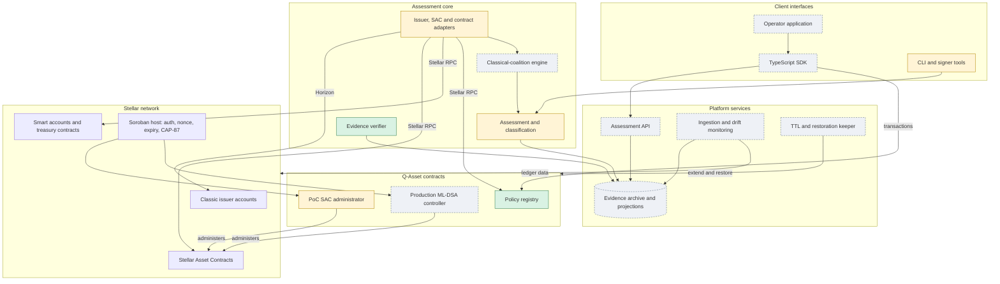

| Layer | Role | Main interactions |
| --- | --- | --- |
| Stellar network | Holds the authority being assessed and the host that enforces Soroban authorization | Read through Horizon and Stellar RPC; written through transactions |
| Q-Asset contracts | Shared declared policy; operation-scoped ML-DSA administration | SAC calls `require_auth` on the controller; the host runs its `__check_auth` |
| Assessment core | Builds authority graphs, computes coalitions, classifies paths, verifies evidence | Reads network state; writes evidence bundles |
| Platform services | Serves assessments, detects drift, maintains contract storage | Ingests ledger data; never holds approval keys |
| Client interfaces | Inspection, policy editing, transaction preparation and signing | Use the SDK; signers stay with the user or an isolated custody service |

### Component architecture

**Asset identity and enrollment — Prototype.** Identifies an issued asset by
network, code bytes and issuer, and derives its SAC address with the official SDK;
contract tokens use their contract ID. The verifier already recomputes the SAC
identity from issuer and code. Registry enrollment uses an `Address` as a tenant
label and does not prove control (see [declared policy](#4-declared-policy-contract)).
Planned: issuer-consented enrollment that links tenant, network, code, issuer and
SAC identity (`FW-SC-01`).

**Native issuer-authority assessment — Prototype.** Reads issuer signers, master
weight, low/medium/high thresholds and asset flags from Horizon and maps them to the
issuer operations they govern. Current code counts only Ed25519 public-key signers
against the medium threshold; this misclassifies some configurations (`FW-STL-01`).
Interface: `scripts/qasset_authority_analyzer.py`. Boundary: Horizon is trusted for
availability and completeness of observations.

**SAC authority assessment — Prototype.** Reads the SAC administrator, the
administrator's executable hash, configured SAC and operator key through Stellar
RPC, and cites recorded probes of `set_authorized`, `mint`, `clawback` and
`set_admin`. Planned: clawback-enabled and trustline-flag coverage (`FW-STL-04`).

**Smart-account and contract adapters — Planned (design unspecified in detail).**
Each adapter pins recognized code hashes, ABI and protocol range, extracts the
authorization rule per operation, and reports unsupported variants as `UNCOVERED`.
No adapter beyond the Q-Asset administrator exists (`FW-SAT-01`).

**Classical-coalition engine — Planned.** Computes, per protected operation, the
minimal sets of classical authorities that satisfy its rule without any
post-quantum participant ([algorithm](#classical-coalition-algorithm)). Interface:
a library consumed by the assessment step; output is part of the evidence schema
(`FW-ARCH-01`).

**Assessment and classification — Prototype.** Classifies every supported path as
`EXPOSED`, `TESTED_PASS`, `TESTED_REJECT`, `DECLARED`, `UNCOVERED`, `STALE` or
`INCONCLUSIVE` and writes a schema-versioned evidence bundle. Implemented for two
reference configurations (`FW-ARCH-02`).

**Evidence verifier — Implemented** for the reference configurations. A separate
implementation that recomputes classifications from raw XDR, checks ML-DSA
credentials and the exact negative mutations, and in live mode rechecks receipts and
tracked configuration. Interface: `scripts/verify_qasset_evidence.py` with
`tools/qasset-evidence-crypto`; exit 0 success, 1 stale or invalid, 2 inconclusive.
Its ML-DSA check uses the same library as the contract (`FW-PQC-03`).

**Policy registry — Implemented** (contract), **Planned** (version 2). A
multi-tenant Soroban contract for declared role quorums with revision-checked
writes and change events. Version 2 adds expected revisions on every mutation,
registrar rotation and report receipts (`FW-SC-01`). Interface: see
[contracts](CONTRACTS.md#registry-api). Boundary: declarations are never enforcement.

**Post-quantum authorization controller — Prototype** (fixed SAC administrator),
**Planned** (production controller). A Soroban custom account that becomes a SAC
administrator and approves only allowlisted operations with ML-DSA. The prototype
accepts one operation, one key and has no handover or rotation; the production
controller adds allowlists, quorums, guarded handover, rotation and address-bound
credentials (`FW-SC-03`, [ADR-008](DECISIONS.md#adr-008-production-controllers-support-guarded-handover-and-address-bound-credentials)).

**Cryptographic verification — Prototype.** ML-DSA-65 verification inside contract
Wasm (RustCrypto `ml-dsa` 0.1.1, unaudited), with domain context. Planned: CAP-87
host verification when Protocol 30 is active (`FW-PQC-04`).

**Key rotation and revocation — Planned.** Part of the production controller
lifecycle. Not possible with the prototype administrator (`FW-SC-03`).

**Monitoring and drift detection — Prototype** (on-demand live verification and a
staleness runner), **Planned** (continuous ingestion and alerts) (`FW-MON-01`).

**SDK, API and operator application — Planned.** Module boundaries, endpoints and
the transaction state machine are specified in
[clients and services](CLIENTS_AND_SERVICES.md) (`FW-SDK-01`, `FW-SDK-02`).

**Signer tooling — Prototype.** `tools/qasset-sac-signer` creates a fresh seed
outside the repository and signs a supplied 32-byte digest deterministically.
Planned: decoded-invocation display, hedged signing and KMS custody (`FW-SEC-01`,
`FW-PQC-02`, `FW-SEC-02`).

**Deployment and operations infrastructure — Planned.** Release manifests, keeper,
hosting and runbooks are specified in [operations](OPERATIONS.md) (`FW-OPS-01`,
`FW-OPS-02`).

**Treasury and institutional integrations — Unspecified.** Required treasury
architectures must be modelled before adapters are designed (`FW-SAT-02`).

### Data architecture

**Authority graph.** Typed, directed graph per asset.

| Node | Examples | Key attributes |
| --- | --- | --- |
| Asset identity | Issued asset (code, issuer), its SAC address | Network, `AUTH_REQUIRED`, `AUTH_REVOCABLE`, `AUTH_CLAWBACK_ENABLED`, `AUTH_IMMUTABLE` |
| Classic account | Issuer, treasury, registrar | Signers, master weight, low/medium/high thresholds |
| Signer | Ed25519 key, Ed25519 signed payload, pre-authorized transaction, hash(x), ML-DSA key | Kind, weight, classical or post-quantum |
| Contract account | Q-Asset controller, supported smart accounts | Code hash, extracted quorum and allowlist |
| Contract authority | SAC administrator, upgrade authority, governance | Holder address, operations it can perform |

Edges: `signs_for(weight)`, `administers`, `authorizes(operation)`, `upgrades` and
`replaces`. Protected operations carry their governing rule:

| Layer | Operation | Governing rule |
| --- | --- | --- |
| Classic issuer | Payment from the issuer (issuance) | Medium threshold |
| Classic issuer | `SetTrustLineFlags` / `AllowTrust` | Low threshold |
| Classic issuer | `Clawback` (if enabled) | Medium threshold |
| Classic issuer | `SetOptions` changing signers or thresholds | High threshold |
| SAC | `mint`, `clawback`, `set_authorized`, `set_admin` | The SAC administrator's authorization |
| Contracts | Upgrade, governance, treasury transfer | The contract's own rule, from a supported adapter |

**Declarations (registry state).** Instance key `ADMIN` (registrar); persistent
`(ASSET, asset) → { admin, revision: u64 }`; persistent `(ROLE, asset, role) →
{ signers: [ { address, algo, weight } ], threshold }` for eight roles (Mint, Burn,
Freeze, Clawback, Treasury, Upgrade, Governance, Recovery). Events: `QuorumSet`,
`AssetAdminChanged`. Declared QS0–QS4 levels are derived values
([rules](#qs0qs4-standard)).

**Controller configuration.** Prototype instance keys `Sac` and `OperatorKey`
(1,952-byte ML-DSA-65 public key). Production configuration (planned): controller
version, network, allowlist of (contract, function, argument constraints), key set
with algorithms and weights, per-operation rule (post-quantum only, or classical
**and** post-quantum), policy epoch, handover quorum and timelock.

**Assessment records.** Schema `qasset-authority-assessment-v2`: network and
passphrase; ledger range; tool name, version and source hashes; per-asset identity
(SAC, issuer, holder, administrator), issuer signers, thresholds and flags,
administrator Wasm hash and policy revision; cryptographic mechanism; hashes of
every input; classified paths; limitations; and a SHA-256 digest of the canonical
body. A path record:

```json
{ "asset": "QEXP", "path": "issuer.classic_mint", "status": "EXPOSED",
  "detail": "Classic issuer Payment succeeded after SAC handover.",
  "citations": [ { "observation_id": "…", "kind": "transaction", "hash": "…" } ] }
```

The reference assessment has 16 paths per asset: `issuer.classic_signers`,
`issuer.classic_mint`, `issuer.trustline_flags`, `sac.admin`, `sac.set_authorized`,
`sac.mint`, `sac.clawback`, `sac.set_admin`, `admin.upgrade`,
`auth.corrupted_signature`, `auth.wrong_network_signature`, `auth.replayed_entry`,
`transaction.source_and_fee_payer`, `registry.admin`, `registry.policy` and
`registry.revision_conflict`. Planned schema additions: coalition results per
operation, adapter versions and report receipts (`FW-ARCH-03`).

**Evidence and audit information.** Deployment records hold transactions,
simulations and their responses; input snapshots hold raw RPC and Horizon
responses; changed inputs are kept by content hash in `evidence/input-archive/`.
On-chain audit information comes from registry events and SAC events. Checksums
identify bytes; they are not signed attestations (`FW-SEC-03`).

### Core operational workflows

**Asset enrollment and identification — Prototype.** The user supplies network,
asset code and issuer; Q-Asset derives the SAC address, records code hashes, and
(planned) links the registry tenant to that identity with issuer consent. An
unrelated registrant is never presented as the issuer.

**Authority discovery and assessment — Prototype.**

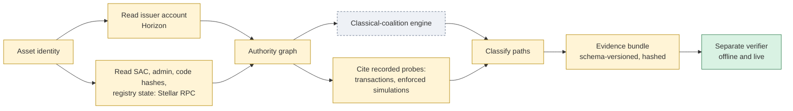

Unknown nodes, unsupported signer kinds, cycles and exceeded bounds produce
`UNCOVERED`; unavailable live inputs produce `INCONCLUSIVE`.

**Policy creation and modification — Implemented** (guarded setter), **Planned**
(version 2). The tenant administrator reads the current revision, submits
`set_role_quorum_if_revision` with that revision, and the registry applies the
change and emits `QuorumSet` with the new revision, or rejects with error 15 and
changes nothing.

```mermaid
sequenceDiagram
  participant Admin as Tenant administrator
  participant Registry as Policy registry
  Admin->>Registry: policy_assessment(asset) returns revision r
  Admin->>Registry: set_role_quorum_if_revision(asset, role, quorum, r)
  alt revision still r
    Registry-->>Admin: Ok; revision r+1; QuorumSet event
  else revision changed
    Registry-->>Admin: Error 15 RevisionConflict; no state change
  end
```

**Authorization enforcement and ML-DSA verification — Prototype.** After the
issuer delegates SAC administration with `set_admin`, every administrative SAC call
requires the controller's authorization.

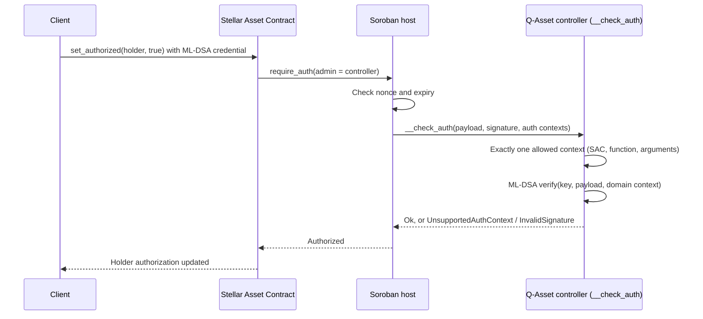

**Key rotation and revocation — Planned.** The production controller replaces a key
through a separately authorized operation under its own domain context and quorum,
with proof of possession of the new key and an optional timelock. Pending
credentials for the old key expire or are invalidated by epoch, and same-invocation
cached authorization is excluded by restrictive scopes (Part II
[enforcement and lifecycle](#6-enforcement-and-lifecycle)).

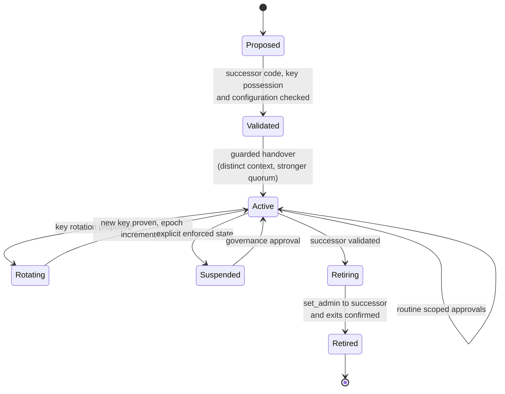

**Administrative handover — Planned** (production), **Implemented once** (initial
delegation). The current SAC administrator authorizes `set_admin` to the new
controller after the controller's code, key possession and configuration have been
validated. The prototype administrator rejects `set_admin`, so delegation to it is
irreversible.

```mermaid
sequenceDiagram
  participant Gov as Handover quorum
  participant Old as Current controller
  participant SAC as Stellar Asset Contract
  participant New as Successor controller
  Gov->>New: Validate code hash, configuration, key possession
  Gov->>Old: Approve set_admin(successor) under handover context
  Old->>SAC: set_admin authorized after timelock
  SAC-->>New: Successor is administrator
  New->>New: Status Active; old controller Retired
```

**Evidence generation and validation — Implemented** for reference configurations.
The analyzer writes the bundle and its digest; the verifier checks input hashes,
schema, credentials, negative mutations and diagnostics offline, and in live mode
rechecks receipts and tracked configuration.

**Monitoring and reassessment — Prototype** (on demand), **Planned** (continuous).

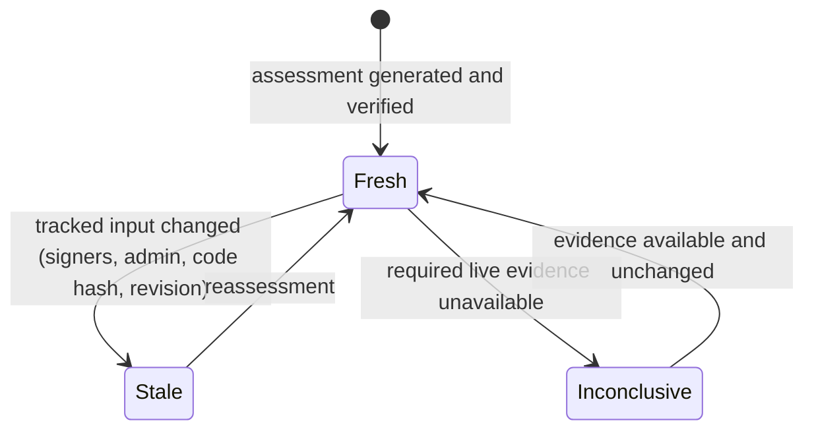

**Integration with other asset and treasury systems — Unspecified.** Supported
smart accounts and treasury contracts are added through adapters that export their
per-operation rules; Q-Asset assesses them and, where delegable, places a controller
in the approval path. Recovery is not part of these workflows; see the
[optional extension](#optional-extension-recovery).

### Security architecture

| Privileged role | Powers | Controlled by Q-Asset? |
| --- | --- | --- |
| Classic issuer signers | Native issuance, trustline flags, clawback if enabled, initial SAC handover consent | No: reported until the issuer restricts them |
| SAC administrator (Q-Asset controller) | SAC `mint`, `clawback`, `set_authorized`, `set_admin` | Yes, within the controller's allowlist |
| Controller key holders | Approve allowlisted operations | Yes: their keys and quorum define the controller rule |
| Registry registrar | Enroll tenants; no override of tenant policy | Registry rules only |
| Tenant administrator | Edit declarations, transfer tenancy | Registry rules only |
| Transaction source and fee payer | Submit and pay; cannot alter contract approvals | No: affects availability only |
| Contract deployer | Chooses constructor arguments | No: configuration must be reviewed before handover |
| Upgrade and governance authorities of integrated contracts | Replace code or rules | Assessed, and enforced only through supported adapters |
| Off-chain operators (analyzer, API, monitor) | Present and withhold information | No approval authority; trusted for availability |

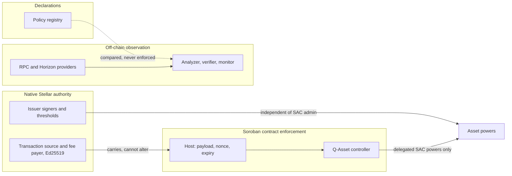

**Native versus contract enforcement.** Native issuer operations are authorized by
the issuer's signers and thresholds and never consult a Soroban contract. SAC
administrative functions are authorized by the SAC administrator, which can be a
Q-Asset controller. Delegating SAC administration therefore does not remove native
issuer powers; only restricting the issuer's own signers does.

**Attack surfaces.** Controller `__check_auth` input (contexts, signature bytes);
constructor configuration; registry mutations; evidence files and provider
responses; signer hosts and key files; API and monitoring services; storage TTL.

**Residual risks.** Unaudited ML-DSA implementation (`FW-PQC-01`); classic issuer
authority outside contract control; legacy credentials without address binding in
the prototype (`FW-PQC-07`); immutable prototype administrator (`FW-SC-03`);
issuer classification defect (`FW-STL-01`); unsigned evidence (`FW-SEC-03`); trusted
providers; storage archival if maintenance stops. Detailed threats and controls:
Part II [threats and operations](#13-threats-and-operations) and the
[threat models](THREAT_MODEL.md).

### Cryptographic architecture

* **Algorithm.** ML-DSA-65 (FIPS 204, pure variant) for controller approvals.
  ML-DSA-44 remains a measured option per controller (`FW-PQC-05`).
* **Message.** The Soroban host computes SHA-256 over the authorization preimage
  (network ID, nonce, signature expiration ledger, invocation tree including
  argument values); ML-DSA signs that 32-byte digest. End-to-end strength is
  therefore bounded by SHA-256 collision resistance (NIST category 2) as well as by
  the signature scheme ([parameters](#cryptographic-parameters-and-signing)).
* **Domain separation.** Each contract verifies with its own context string, such
  as `qasset-sac-admin-auth-v1`; signatures for one controller or purpose fail in
  another.
* **Replay protection.** The host consumes nonces and enforces expiration; the
  controller adds context scoping. Address-bound credentials (CAP-71-02) add the
  authorizer address to the preimage and are required for production controllers
  (`FW-PQC-07`).
* **Validation.** Key and signature lengths are checked before decoding; malformed
  encodings, including non-canonical hints, are rejected. Public ACVP and Wycheproof
  vectors run against the administrator's `__check_auth`
  (`contracts/qasset-sac-admin/tests/ml_dsa_vectors.rs`).
* **Signing.** The prototype signer signs deterministically over a supplied digest.
  Production signers use hedged signing and show the decoded invocation
  (`FW-PQC-02`, `FW-SEC-01`).
* **Dependencies.** RustCrypto `ml-dsa` 0.1.1 inside Wasm; no external audit
  (`FW-PQC-01`).
* **Agility.** CAP-87 provides pure ML-DSA-44/65/87 host verification with a context
  string, so existing keys, messages and domain contexts carry over; its failure
  behavior (host trap) is versioned in evidence (`FW-PQC-04`). Hybrid rules
  (classical **and** post-quantum) are a per-operation configuration (`FW-AUTH-01`).

### Integration architecture

| Integration | Required permission | Q-Asset role | Security assumption |
| --- | --- | --- | --- |
| Classic issuer account | Read only (Horizon); issuer signs any restriction itself | Assess and report | Issuer controls its own migration |
| Stellar Asset Contract | Current administrator authorizes `set_admin` to a controller | Assess; enforce delegated administration | SAC semantics per CAP-46-06 |
| Custom smart accounts | Read code and configuration; adapter support | Assess; optionally act as an approver | Recognized code hash and adapter correctness |
| Tokenization platforms | Asset identities and intended roles | Assess their issued assets | Platform-side controls stay with the platform |
| Treasury infrastructure | Policy and contract configuration | Assess; enforce where a controller can be placed | Unspecified until modelled (`FW-SAT-02`) |
| Stellar RPC and Horizon | Network access | Observation and submission | Trusted for availability, not for authority claims |
| Wallets and custody | Signing capability for ML-DSA approvals | Approval signing | Must show the decoded invocation |

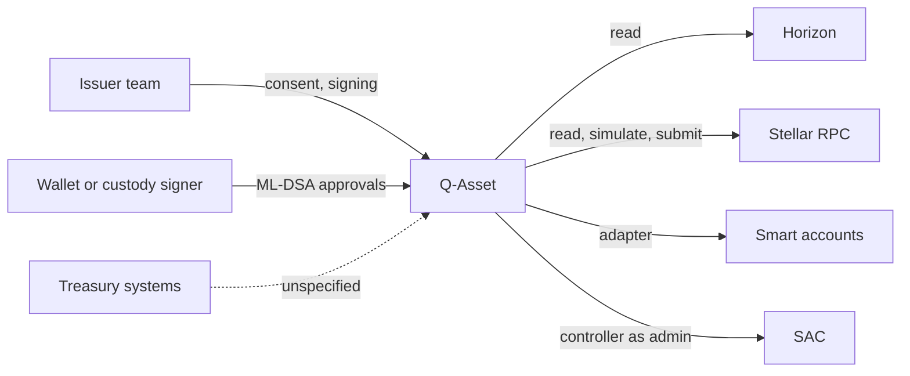

### Deployment architecture

* **Contracts.** Built from the locked workspace for `wasm32v1-none` with Rust
  1.94.1; reference Wasm hashes are recorded and checked. Each contract is
  initialized atomically by its constructor (registry: registrar; administrator:
  SAC and operator key), so no separate initializer can be front-run. The
  administrator's constructor does not authenticate its caller, so its
  configuration must be verified before any `set_admin`.
* **Network configuration.** Current scripts embed Testnet endpoints and the
  Testnet passphrase (`FW-DEV-01`). Planned: a release manifest with network
  passphrase and ID, network generation, endpoints, accepted protocol range,
  contract IDs and code hashes, compared with live state before signing
  ([network configuration](#8-network-configuration-and-deployment-provenance)).
* **Environments.** Local tests run in the Soroban host test environment. All
  recorded deployments are on Testnet and are disposable; Testnet resets clear
  them. No Mainnet deployment exists; a Mainnet release requires reviewed
  contracts, a release manifest and operational controls.
* **Operational dependencies.** Funded source and fee accounts, RPC and Horizon
  access, TTL maintenance, evidence storage and, for services, hosting described in
  [operations](OPERATIONS.md).

### Monitoring and observability

| Capability | Status | Mechanism |
| --- | --- | --- |
| Live recheck of an assessment | Implemented | Verifier rechecks receipts, code hashes, issuer signers, thresholds and flags, SAC administrator, operator key, quorums and registry revision |
| Revision-change detection | Implemented | Registry revision comparison; demonstrated by marking 16 of 32 paths stale |
| Contract events | Implemented | Registry `QuorumSet` and `AssetAdminChanged`; SAC events |
| Continuous ingestion and drift detection | Planned | Workers ingest ledger data, detect tracked changes and trigger reassessment (`FW-MON-01`) |
| Alerts and freshness API | Planned | Freshness state on every API response (`FW-MON-02`) |
| TTL monitoring and maintenance | Planned | Keeper extends and restores dependencies (`FW-OPS-01`) |

### Lifecycle and operational management

* **Contract upgrades.** No current contract exposes an upgrade method. Changes ship
  as new versioned deployments; constructors do not rerun on upgrade.
* **State migration.** A new registry version is a new deployment; declarations are
  re-recorded with consent and old addresses are retained as history.
* **Signer replacement.** Production controllers rotate keys under a separate
  context and quorum; the prototype administrator cannot (`FW-SC-03`).
* **Administrator changes.** Guarded `set_admin` handover between controllers;
  registry tenancy transfers need outgoing and incoming consent.
* **TTL, archival and restoration.** Persistent and instance entries archive and can
  be restored; temporary entries expire permanently. Restoration must preserve
  administrators, revisions and epochs (Part II [storage](#10-storage-and-resource-lifecycle)).
* **Emergency procedures.** There is no hidden pause key. Production controllers
  provide an explicit `Suspended` state; disabling a website or relay does not stop
  on-chain calls.
* **Operational recovery.** Durable transaction journals, reconciliation of unknown
  outcomes and restore drills ([operations](OPERATIONS.md)).

### Architecture decisions and trade-offs

| Decision | Trade-off | Record |
| --- | --- | --- |
| Declarations are separate from verified authority | Useful intent analysis now; no on-chain gate until classic-state verification is solved | [ADR-001](DECISIONS.md#adr-001-declarations-remain-separate-from-verified-authority) |
| Analysis off-chain, enforcement on-chain | Rich analysis and evidence without on-chain cost; observers are trusted for availability | ADR-003 |
| Immutable single-operation administrator for the prototype | Narrow, testable authority; no rotation or handover | [ADR-002](DECISIONS.md#adr-002-immutable-scoped-sac-administrator-for-the-reference-experiment) |
| Guarded handover and address-bound credentials for production | More lifecycle surface to test; avoids lock-in and cross-account replay | [ADR-008](DECISIONS.md#adr-008-production-controllers-support-guarded-handover-and-address-bound-credentials) |
| ML-DSA-65 verified in Wasm now, CAP-87 later | High cost today; compatible migration path | [ADR-007](DECISIONS.md#adr-007-ml-dsa-parameters-signing-and-test-vectors) |
| Security over availability | Unsupported inputs fail closed; missing data is inconclusive | Principles above |
| Durable indexing for monitoring | Database and history costs; reproducible history | [ADR-003](DECISIONS.md#adr-003-production-monitoring-requires-durable-indexing) |
| Recovery kept optional | Core platform ships independently of research outcomes | [ADR-005](DECISIONS.md#adr-005-keep-seed-recovery-conditional-and-independently-gated) |

### Implementation maturity

| Component | Intended responsibility | Status | Source | Tests | Missing functionality | Dependencies | Remaining validation |
| --- | --- | --- | --- | --- | --- | --- | --- |
| Policy registry | Declared policy, revisions, events | Implemented | `contracts/qasset-registry/src/lib.rs` | `contracts/qasset-registry/src/test.rs` (36) | Expected revisions everywhere, registrar rotation, receipts (`FW-SC-01`) | — | External review |
| SAC administrator (prototype controller) | Operation-scoped ML-DSA SAC administration | Prototype | `contracts/qasset-sac-admin/src/lib.rs` | `src/test.rs` (21), `tests/ml_dsa_vectors.rs` (3) | Allowlist, quorum, handover, rotation, address-bound credentials | — | External review |
| Production controller | Same, with full lifecycle | Planned | — | — | All (`FW-SC-03`) | ADR-008 | Design review, tests, audit |
| ML-DSA verification | Signature checks with domain context | Prototype | `ml-dsa` 0.1.1 in the administrator | Contract tests and public vectors | CAP-87 back end, second implementation | Protocol 30 | External cryptographic review |
| Issuer and SAC analyzer | Read authority, classify paths | Prototype | `scripts/qasset_authority_analyzer.py` | `scripts/test_qasset_authority_analyzer.py` | Generic adapters, all signer kinds and thresholds (`FW-STL-01`, `FW-ARCH-02`) | — | Reference cases |
| Classical-coalition engine | Minimal classical coalitions per operation | Planned | — | — | All (`FW-ARCH-01`) | Schema v3 | Oracle validation |
| Evidence verifier | Independent recomputation and live recheck | Implemented | `scripts/verify_qasset_evidence.py`, `tools/qasset-evidence-crypto` | `scripts/test_qasset_evidence.py` | Second ML-DSA implementation, attestations | — | — |
| Staleness and monitoring | Detect changes, reassess | Prototype | `scripts/qasset_poc_staleness.py` | `scripts/test_qasset_poc_staleness.py` | Continuous services (`FW-MON-01`) | Indexer | Drift drills |
| Testnet runner | Disposable deployment and probes | Prototype | `scripts/qasset_poc_testnet.py` | `scripts/test_qasset_poc_testnet.py` | Release manifests | — | — |
| Operator signer | Key creation and signing | Prototype | `tools/qasset-sac-signer` | 4 unit tests | Hedged signing, invocation display, KMS | — | Custody review |
| Smart-account adapters | Extract contract rules | Planned | — | — | All (`FW-SAT-01`) | Adapter interface | Hostile configuration tests |
| Treasury integrations | Treasury authority coverage | Unspecified | — | — | Design (`FW-SAT-02`) | Treasury models | — |
| SDK, API, operator app | Developer and operator access | Planned | — | — | All (`FW-SDK-01`, `FW-SDK-02`) | Schemas | Packaging, accessibility |
| Deployment and operations | Manifests, keeper, hosting | Planned | — | — | All (`FW-OPS-01`, `FW-OPS-02`) | Owners appointed | Restore drills |
| Recovery (optional) | Account-control recovery | Research | `contracts/pq-recovery-demo`, `contracts/seed-recovery-verifier`, `contracts/recovery-proof-mailbox` | 14, 6 and 13 tests | Feasible verifier, lifecycle (`FW-OPT-*`) | Independent review | Not required by the core |

### Limitations and architectural evolution

Current constraints: the proof of concept covers two synthetic Testnet assets and
one SAC operation; the administrator is immutable; issuer classification is
incomplete; there are no services, SDK or monitoring; evidence is unsigned; the
ML-DSA implementation is unaudited; there is no repository license yet.

The architecture evolves without discarding what works:

1. **Assessment core.** Generalize adapters, add the coalition engine and schema v3,
   and fix issuer classification, keeping the verifier as an independent check.
2. **Policy and enforcement.** Deploy registry version 2 and the production
   controller with guarded handover, rotation and address-bound credentials, on
   Testnet first.
3. **Services.** Add ingestion, monitoring, API and SDK on the evidence schema.
4. **Agility.** Move verification to CAP-87 when Protocol 30 is active, with the same
   keys and contexts.
5. **Integrations.** Add smart-account and treasury adapters once their authority
   models are specified.

Each step has entries in the [future-work register](FUTURE_WORK.md).

### Optional extension: recovery

Recovery of account control is an optional extension. No core capability depends
on it, and it is not a committed feature. Three research components exist:

* **Enrolled ML-DSA recovery counter (prototype).** A pre-enrolled backup key plus
  proof of possession of a different replacement key replaces the active key once,
  bound to network, contract, epoch and expiry. An authorization-caching flaw found
  in review was fixed by restricting the account to its own counter; the fix has
  not been redeployed.
* **Disabled seed-recovery account (research).** Always rejects; reserved for a
  future proof backend.
* **Proof mailbox (research).** Stores large proofs in ordered chunks; it never
  verifies them.

Measured status: a 539,888-byte proof verifies in a 127,068-byte raw Wasm module,
but the Soroban SDK wrapper exceeds the code-size limit and the 400 million
instruction budget. Quantum soundness, privacy and the complete recovery lifecycle
remain open. Details: Part II [recovery extension](#7-conditional-recovery-extension),
[recovery status](RECOVERY_IMPLEMENTATION_STATUS.md) and `FW-OPT-*` items in the
future-work register.

### Classical-coalition algorithm

For each protected operation, the engine computes the minimal sets of classical
authorities that satisfy its rule without any post-quantum participant. A
coalition is minimal when removing any member breaks it. Ed25519 keys, Ed25519
signed-payload signers and secp256r1 smart-account signers are classical;
pre-authorized-transaction and hash(x) signers are reported as non-key authorities;
ML-DSA signers count as post-quantum only where enforcement is established.

```text
coalitions(node, op):
  if node is unsupported or unknown:          return UNCOVERED
  T  := threshold(node, op)
  C  := classical members of node, sorted by weight (descending)
  out := []
  search(i, chosen, w):
    if w >= T:                                 # rule satisfied
      if no proper subset of chosen meets T:   # minimality
        out.append(chosen)
      return
    if i == len(C) or w + remaining_weight(i) < T:
      return                                   # bound: cannot reach T
    search(i+1, chosen + [C[i]], w + weight(C[i]))
    search(i+1, chosen, w)
  search(0, [], 0)
  expand members that are contract or account nodes by their own coalitions,
  within node and coalition ceilings; an exceeded ceiling returns UNCOVERED
  return out
```

A classic account holds at most 20 signers plus its master key, so a per-account
search is bounded by 2^21 subsets before pruning. Per operation the engine reports
the minimal coalitions and their sizes, whether a classical-only path exists, and
whether legacy Ed25519 signers alone still meet the threshold after post-quantum
signers are added. Results are validated against a brute-force subset oracle.

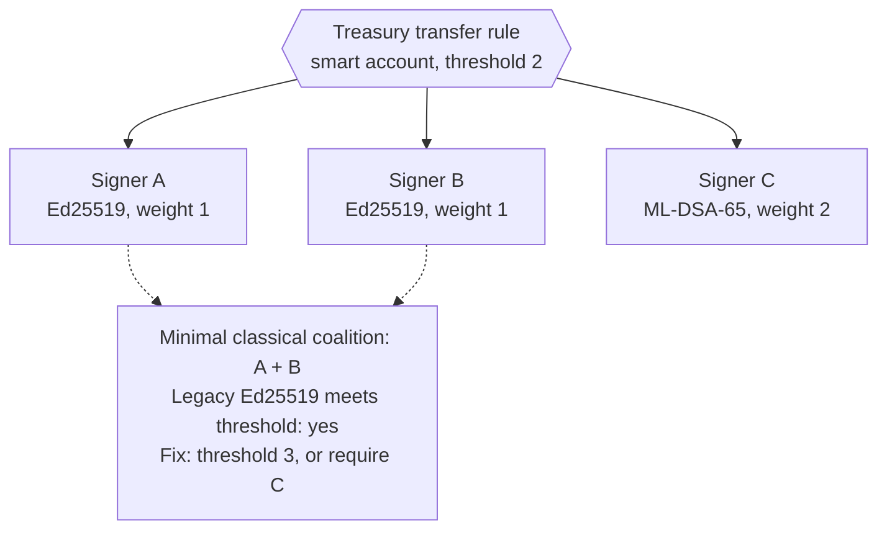

### Measured proof-of-concept results

| Measurement | Value |
| --- | --- |
| Contracts | Five Rust/Soroban contracts; 93 contract tests, 4 signer tests and 124 Python tests passing |
| Registry Wasm | 28,553 bytes, SHA-256 `26f684ed…a207` |
| SAC administrator Wasm | 59,167 bytes, SHA-256 `f7ed9b81…72b6` |
| ML-DSA-65 sizes | 1,952-byte public key; 3,309-byte signature |
| Authorized `set_authorized` call | About 102.5 million instructions; about 57,900–59,200 stroops estimated resource fee |
| Testnet run | 28 successful transactions, 10 rejected enforced simulations, 1 rejected submission |
| Reference assessment | 32 paths: 5 exposed, 4 tested-pass, 11 tested-reject, 10 uncovered, 2 declared |
| Freshness | A policy revision marked 16 of 32 paths stale; the verifier exited 1 |
| Storage | Instance TTL target 120,960 ledgers, about seven days at five seconds per ledger |

## Part II — Detailed specifications

## 1. Product, requirements and economics

Q-Asset helps issuers, treasury operators, custodians and reviewers identify and
strengthen effective authority over Stellar assets. It combines declared policy
arithmetic, supported authority-path analysis, operation-specific enforcement
and reproducible assessments. Every supported path that can issue assets, move
balances or replace a stronger rule must be examined. Assessments explicitly
identify uncovered paths.

| User | Completed-product workflow | Required outcome |
| --- | --- | --- |
| Issuer administrator | Discover issuer/SAC authority, declare intent, compare and delegate supported operations | Exact identity and visible classic issuer residual powers |
| Treasury operator and approvers | Inspect custody, prepare, approve, execute and reconcile transfers | Exact amount/destination; current policy; no weaker override |
| Security reviewer | Download inputs, reproduce classifications and verify receipts | Versioned evidence, scope and freshness boundaries |
| Operations team | Monitor drift, fund fees, retain TTL and restore | Visible gaps; restoration preserves authority |
| Owner, conditional recovery extension | Enroll/revoke recovery eligibility and replace authority | Current entitlement, replacement possession and one-time consumption |

The repository defines **no Q-Asset token, staking, yield, lending, redemption
price, revenue split, per-assessment charge or protocol fee**. QEXP and QCTL are
synthetic Testnet assets. Reserve backing, beneficial ownership, legal redemption
and compliance decisions belong to issuers/custodians; these contracts do not
establish them. Commercial service pricing is unresolved.

Actual costs are network fees in XLM, classic account/trustline reserves,
Soroban resource/rent/restoration charges, infrastructure and custody. A source
pays transaction fees unless a fee-bump payer covers them; reserve sponsorship
is a different mechanism. The target service funds relay/maintenance accounts
under explicit budgets. Sponsorship gives no asset approval. Funding failure
must never weaken an approval policy.

Requirements and exclusions:

* Scope every result to network, deployment generation, asset and operation.
  Keep declarations, tested observations and unknowns distinct.
* Enumerate issuer, governance, upgrade, recovery, pause, delegation and other
  bypass paths for each supported integration. Eight role labels are not proof
  of complete coverage.
* Keep mnemonic, seed, signing secrets and private customer/compliance data off
  chain. Public evidence should be downloadable and reproducible.
* Treat consensus/host correctness, cryptographic assumptions, key custody and
  provider integrity as separate boundaries. Checksums identify bytes, not truth.
* Do not promise quantum-safe SCP/envelope signatures, arbitrary bytecode
  analysis, retroactive control of classic accounts or automatic regulatory compliance.
* Unsupported code, signer/credential variants and token semantics fail explicitly.

## 2. Implementation boundary and topology

| Component | Current | Target |
| --- | --- | --- |
| `qasset-registry` | Declaration arithmetic, guarded revision writes, events; verified gates unavailable | Preserve declarations; version any verified integration separately |
| `qasset-sac-admin` | Immutable SAC/key; ML-DSA-65 for one direct `set_authorized` auth context | Audited scoped enforcement and separately reviewed lifecycle |
| Analyzer/verifier | Python, two reference configurations, schema v2, raw evidence checks | Versioned adapters, classical-coalition engine, monitoring, archive and API |
| Operator signer | Unix tool, fresh external key file, signs supplied digest | Isolated policy-aware custody service |
| dApp/public SDK | Absent | Inspection, declaration, scoped write, export and recovery flows |
| Indexer/API/relay/keeper | No production service, database or scheduler | Durable history, freshness, bounded delivery and maintenance |
| PQ recovery counter | Local restricted candidate with public fixture keys | Optional independently reviewed account integration |
| Seed verifier/mailbox | Authentication disabled; transport is unverified | Conditional research extension after all acceptance gates |

Current implementation sources: [registry](../contracts/qasset-registry/src/lib.rs),
[administrator](../contracts/qasset-sac-admin/src/lib.rs),
[analyzer](../scripts/qasset_authority_analyzer.py),
[verifier](../scripts/verify_qasset_evidence.py), and
[signer](../tools/qasset-sac-signer/src/main.rs). All five contract packages have
`publish = false`. There are no checked-in CI workflows or production hosting definitions.

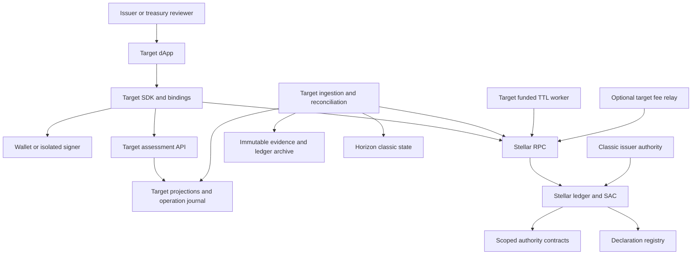

Target initial hosting consists of a static web origin, stateless API,
independently restartable ingestion/reconciliation/maintenance workers, a
relational database and immutable blob storage. Database job leases and an outbox
suffice initially; no message broker is required. Provider, redundancy and service
objectives require deployment qualification. Isolate networks and credentials.
The API holds no user approval keys. Signer processes and optional relay envelope
keys have separate identities and funding boundaries. An API compromise may
mislead or withhold information; signing and enforcement still bind the exact action.

## 3. Identity, authority graphs and evidence

The registry's `asset: Address` is a tenant label. Issued-asset identity comprises
network, exact code bytes and issuer; derive the SAC address with the official
SDK. XLM has a native identity; contract tokens use their network and contract
ID. Tickers, domains, logos and enrollment do not establish identity or control.

Target authority graphs have typed account, contract, key, quorum and policy
nodes and directed operation/replacement edges. Each adapter pins recognized
code, ABI, protocol range, signer formats, completeness assumptions and unsupported
cases. Traverse with visited-node detection and qualified depth/node/edge ceilings;
cycles or exhausted bounds produce `UNCOVERED`, never assumed protection. Code
identity alone does not prove policy correctness or independent key custody.

### Classical-coalition analysis

The algorithm, signer classification, bounds and an example are specified in
[Part I](#classical-coalition-algorithm). Current status: not
implemented. The registry evaluates only the declared predicate `C >= T` per role,
and the PoC analyzer compares summed Ed25519 weight with the medium threshold for
two reference configurations.

Current path statuses are `DECLARED`, `TESTED_PASS`, `TESTED_REJECT`, `EXPOSED`,
`UNCOVERED`, `STALE` and `INCONCLUSIVE`. Verifier `INVALID` describes evidence
failure, not a QS level. There is no overall asset safety score. Future signed
attestations must bind evidence hash, adapter/tool versions, network/generation,
ledger range, configuration, scope and expiry, with an approved attester key and
revocation policy. They do not expand the evidence's scope or establish live authority.

Current reads span a ledger interval. Repeating a registry revision detects some
concurrent changes, not an atomic issuer/SAC/registry snapshot. Target ledger
metadata ingestion constructs views at a complete common ledger boundary and
reconciles point reads. APIs expose that watermark and disagreements. Missing or
unsupported dependencies invalidate the affected freshness claim.

## 4. Declared policy contract

The [contract reference](CONTRACTS.md#registry-api) owns exact signatures, storage,
events and errors. A constructor fixes the registrar without requiring its
consent; deployment review must independently verify that address. Enrollment
requires registrar and incoming tenant consent. Transfer requires outgoing and
incoming tenant consent, with no registrar override. No registrar rotation,
deregistration, role deletion or upgrade entry point exists.

Tenants start at revision 0. Accepted quorum writes and tenant-admin transfers
increment checked `u64` revisions, even for unchanged values.
`set_role_quorum_if_revision` rejects a stale expected revision with error 15.
The unconditional setter and admin transfer offer no compare-and-set. The eight
role entries are independently bounded. There is no global tenant enumeration/cap;
the target catalog derives membership from indexed enrollment events.

### QS0–QS4 standard

These are repository-local **declaration predicates**, not an external certification
standard. Let `C` be classical-labelled weight, `P` PQ-labelled weight, `Pmax` the
largest single PQ-labelled weight and `T` the threshold. Missing roles are weak;
present roles are weak if `C >= T`. Highest-impact roles are Treasury, Upgrade
and Governance.

| Level | Exact declared condition |
| --- | --- |
| QS0 | No PQ label anywhere |
| QS1 | A PQ label exists and a highest-impact role is weak |
| QS2 | No highest-impact role is weak, but another role is weak |
| QS3 | All eight roles exist and require PQ-labelled contribution |
| QS4 | QS3 and `C + Pmax < T` for each highest-impact role |

Classical weight 1 plus PQ weight 1 at threshold 2 is QS3 when used for all roles.
Classical weight 1 plus two PQ weights 1 at threshold 3 meets the extra QS4 rule.
Different addresses need not represent independent keys/operators. A nonexistent
authority needs adapter-validated non-applicability; omission is unknown today.

Quorums contain at most 20 unique addresses, each weight 1–255, and
`0 < T <= C + P`. Total weight is at most 5,100. Duplicate checks are quadratic
but bounded; analysis iterates eight bounded roles. These are metadata limits,
not classic Stellar signer limits or production cryptographic capacity.
`policy_assessment` requires enrollment and returns observation ledger, revision,
declared level and `Unverified`. Direct declaration reads can return QS0/missing
roles for an unknown tenant. Both verified APIs return `UnverifiedPolicy`, even
when asked for QS0.

## 5. Assets, custody and accounting

Current Q-Asset contracts hold no escrow or token balance ledger. The SAC
administrator changes holder permissions; it cannot transfer, mint, burn or claw
back. Target integrations retain balances in the token ledger and approvals in
an account/policy controller. A custody contract would require additional audited
accounting and exit rules.

The [SAC specification](https://github.com/stellar/stellar-protocol/blob/master/core/cap-0046-06.md)
distinguishes holder operations from issued-asset administration. XLM's SAC has
no issuer administrator. Inspect issued-asset `AUTH_REQUIRED`, `AUTH_REVOCABLE`,
immutable flags and per-balance/trustline clawback eligibility; new flags do not
establish all historical trustlines' capabilities. Classic holders require
trustlines, authorization, capacity and reserves. Contract balances have storage
lifetimes and are not classic trustlines. For a classic trustline, SAC
`set_authorized(false)` selects authorization to maintain liabilities rather
than deleting offers/pool positions; do not label it an unconditional full freeze.

| Operation | Authority/accounting boundary |
| --- | --- |
| Transfer | Supported ordinary nonissuer holder/spender path; exact debit equals credit |
| Approve / transfer_from | Holder establishes allowance/expiry; spender may use it without fresh holder approval |
| Burn | Holder or approved spender; destroys units |
| Mint | Issued-asset SAC admin, or separate classic issuer issuance path |
| Set authorization | SAC admin; separate issuer trustline operations remain |
| Clawback | Admin/issuer authority and applicable enabled state; destroys units rather than transferring to a wallet |
| Set SAC admin | Current admin consent; independently test new address and configuration before handover |

[SEP-41](https://github.com/stellar/stellar-protocol/blob/master/ecosystem/sep-0041.md)
is an interface, not proof of arbitrary token economics. Allowances are spending
authority, not reservations. Outstanding approvals, native offers/liabilities,
sponsored reserves and custody overrides belong in treasury coverage. Prefer
direct transfer; allowance support needs expiration, revocation and replacement-race handling.

SAC handover leaves classic issuer powers effective unless separately retired.
The [custom-admin guide](https://developers.stellar.org/docs/build/guides/tokens/custom-sac-admin)
warns that locking an issuer before handover can make the handover impossible.
Production retirement needs a reviewed issuer-specific migration and verified
replacement operation before any irreversible step. The disposable lock runner
is not a production migration tool.

### Precision and conservation

SAC amounts have seven decimal places: one unit is `10_000_000` base units.
Use decimal strings at API boundaries and checked integer arithmetic. Reject
negative transfers, excess precision, scientific notation and implicit rounding.
The ABI is `i128`; classic balance/trustline operations also face signed `i64`
limits, liabilities and reserves. Check the destination representation, not just
the wider ABI. Other contract tokens need explicitly supported decimals and
semantics. See [Stellar's examples](https://developers.stellar.org/docs/build/guides/tokens/stellar-asset-contract).

For supported ordinary nonissuer transfers, conservation is
`debit = credit = amount`. Issuer issuance/redemption and explicit mint/burn/
clawback require separate supply-effect classification; a method name alone
does not establish conservation. The SAC has no `total_supply` method, and a
projection of tracked balances is not a global supply or reserve attestation.
[CAP-67](https://github.com/stellar/stellar-protocol/blob/master/core/cap-0067.md)
defines issuer-related mint/burn event semantics for ingestion. Network fees affect the XLM payer
separately. No service fee may silently reduce principal. No percentage/rounding
rule exists in current economics. Reconcile token effects, allowances and fees
independently; a cached balance establishes no spending authority or redemption backing.

## 6. Enforcement and lifecycle

Current `QAssetSacAdmin` fixes a SAC and 1,952-byte ML-DSA-65 key in instance
storage. `__check_auth` admits one contract auth context: configured SAC,
`set_authorized`, two arguments. It verifies a 3,309-byte signature over the host
digest with context `qasset-sac-admin-auth-v1`. The host binds argument values;
the SAC decodes their types. There is no outgoing SAC invocation, rotation,
recovery, upgrade or other administrative method. Constructor decoding establishes
key length, not possession or SAC trustworthiness. Test configuration before handover.

Auth contexts are authorization-relevant contexts, not a view of every
unauthenticated call-stack ancestor. The guard rejects tested composite/nested
authorizations; it is not a universal call-graph verifier. Direct-invoker
authorization is distinct: a controller calling its SAC can authorize as invoker
without running its own `__check_auth`. Any such public dispatch method must
enforce policy itself. See [authorization](https://developers.stellar.org/docs/learn/fundamentals/contract-development/authorization).

### Target production controller

Rotation, weighted approvals, treasury transfer and upgrade support require a
new versioned controller. Bounded configuration includes operations, independent
key identities, verifier/code pins, quorums, policy epoch and explicit governance/
recovery paths. Unsupported inputs have no permissive fallback.

Unlike the PoC administrator, every production controller supports **guarded
administrative handover**: SAC `set_admin` to a successor is authorized under a
distinct ML-DSA domain context, a stronger quorum than routine operations and an
optional timelock, and the successor is validated before activation. Key rotation
and migration to a successor controller, including one using CAP-87 host
verification, therefore never require an impossible handover. Controllers accept
only address-bound credentials (§9). See
[ADR-008](DECISIONS.md#adr-008-production-controllers-support-guarded-handover-and-address-bound-credentials).

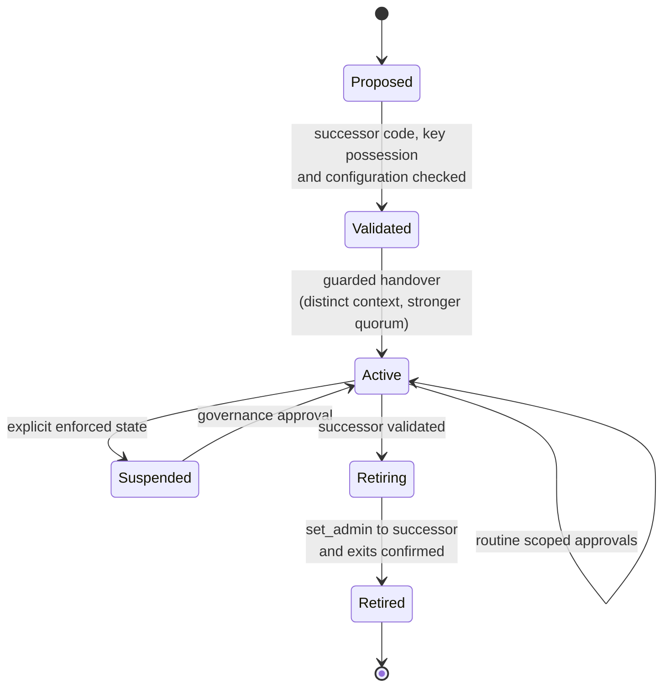

A target treasury `execute` intent binds network, controller, token, operation,
destination, exact amount, expected epoch, nonce and expiry. The execution method
checks current epoch after authorization and immediately before dispatch, and
consumes an intent nonce atomically with effects. Callbacks/subsequent actions
must recheck authority across policy mutations. Governance increments checked
epochs. Batching remains disabled until the cache and execution model passes
independent validation. All direct-invoker paths require equivalent checks.

Initially retain immutable scopes for direct SAC authentication. A dynamic epoch
check only inside `__check_auth` cannot revoke already cached same-tree authority.
Mutable SAC administration requires a separately reviewed dispatch design with
operation-time checks or restrictive scopes; general mutable direct-SAC auth is
not established here. The present fixed administrator cannot hand over to a new
contract later. Selecting it forecloses rotation and software migration.

Target lifecycle is `Proposed -> Validated -> Active -> Retiring -> Retired`;
`Suspended` is an explicit enforced state. Activation needs outgoing consent and
incoming proof of possession; retirement needs usable replacement authority and
exits. Emergency paths cannot be weaker than their stated guarantee. Key counts,
timelocks and emergency procedures need deployment-specific cost/security review;
the registry's 20 metadata entries are not a signature budget.

### Cryptographic parameters and signing

See [ADR-007](DECISIONS.md#adr-007-ml-dsa-parameters-signing-and-test-vectors).
Soroban authorization payloads are SHA-256 digests of the authorization preimage,
and ML-DSA signs that 32-byte digest. End-to-end authorization strength is
therefore bounded by SHA-256 collision resistance (NIST category 2) as well as by
the signature scheme; ML-DSA-65 (category 3) does not raise the system above that
bound. ML-DSA-65 is retained for margin against ML-DSA-specific cryptanalysis and
alignment with SDF's plan. ML-DSA-44 (1,312-byte keys, 2,420-byte signatures) stays
a qualified option for cost-sensitive controllers, decided with measured costs.

* Production signers use FIPS 204 **hedged** signing. Deterministic signing, used
  by the PoC signer, is limited to reproducible test vectors.
* Every verification path, in Wasm or through CAP-87, runs NIST ACVP and
  Wycheproof vectors including malformed key, signature and hint encodings. The
  PoC runs these vectors only on the recovery counter.
* Evidence verification uses a second, independent ML-DSA implementation. The PoC
  evidence helper reuses the contract's `ml-dsa` crate, so its agreement is not
  independent.
* Signers decode and display the exact invocation before signing. The PoC signer
  signs a supplied digest and is not a production custody design.

### Verified gate boundary

Off-chain assessments do not enable `require_min_qs`. A target adapter must
establish actual policy, complete bypass coverage and freshness at the protected
operation, including verifier/upgrade identity. For supported contract state,
perform checks in the same invocation and propagate errors. RPC/Horizon responses
are not on-chain facts without an explicit authenticated bridge and threat model.
Verification of arbitrary classic issuer/signer state inside a contract remains
an unresolved integration. Until its trust model and mechanism pass review,
classic coverage stays off-chain and verified registry gates stay disabled.

## 7. Conditional recovery extension

Recovery does not block assessment/scoped-enforcement delivery. The
[contract reference](CONTRACTS.md#recovery-components) specifies actual interfaces.
The ML-DSA counter requires owner consent at construction, distinct active/backup
keys, and one-shot recovery with enrolled backup signature plus replacement
possession. Network/contract/domain, expected epoch and inclusive expiry within
1,000 ledgers are bound. Success increments epoch and consumes recovery. The owner
has no later bypass. Only its own argument-free `protected` counter is authorized.
The patched candidate's redeployment is not established by retained receipts.

`SeedRecoveryVerifier` stores immutable owner/key/path configuration and always
rejects authentication. There is no activation method. Future support requires
a new implementation. Distinguish raw 32-byte Ed25519 leaf seeds from supported
SEP-5 roots and exact `m/44'/148'/n'`, with `n < 2^31` before hardening.
[SEP-5](https://github.com/stellar/stellar-protocol/blob/master/ecosystem/sep-0005.md)
defines derivation compatibility, not entropy or current entitlement.

The target statement binds account-selected protected key/current policy,
network, contract, program/verifier/parameters, witness mode/path, epoch,
eligibility, action, replacement policy/key, nonce and expiry. Atomic consumption
verifies the complete proof and replacement possession, rechecks revocation and
expiry, replaces authority and consumes entitlement once. An old owner's genuine
seed is insufficient after revocation. Operation-time checks cover cached auth.

Exact backend/composition/parameters need specialist quantum proof-of-knowledge
and privacy review. Ordinary soundness for a true public key statement is not
knowledge authentication. Pairing compression cannot inherit a PQ claim.
Scalar-output experiments disclose a functioning classical signing secret:
every effective or reused classical path must be retired with ledger finality
before disclosure, including to RPC/proving services. Public retire-and-reveal
in one transaction leaves a prepublication race.

Mailbox sealing proves byte consistency only. Its consumer would need complete
proof verification and current policy checks in the atomic transition. No trusted
off-chain approval gateway silently substitutes for an infeasible verifier.
SDK-host code-size and CPU blockers remain open despite raw Wasm success. See
[successor evidence](VERIFIER_NEXT_EVIDENCE.md) and
[security argument](RECOVERY_SECURITY_ARGUMENT.md).

## 8. Network configuration and deployment provenance

Current evidence is Testnet-only. The reference locks Rust 1.94.1, Soroban SDK
25.3.2, host 25.2.2, XDR 25.0.0, Python `stellar-sdk` 14.0.0 and `ml-dsa` 0.1.1.
Workspace `soroban-sdk = "25"` is a range; `Cargo.lock` defines the build.
Research tools have separate locks. The CLI26/protocol29 limits record is explicitly
partial. Historical counts/identities live in the [evidence guide](QASSET_POC_EVIDENCE.md).

The [Bell guide](https://stellar.org/blog/developers/bell-protocol-30-upgrade-guide)
lists Testnet/Mainnet votes for 2026-11-03/2026-11-23 and requires CAP-88-aware
ledger decoders. As of 2026-11-07 the Testnet vote outcome is not confirmed by
the official guide (last updated 2026-10-23) or the software-versions page.
A scheduled vote does not prove activation. Qualify actual
network/protocol/capabilities. CAP-84 muxed contract destinations require updated
address/event decoding and role validation; older tools must reject unsupported
variants explicitly. Ledger windows do not imply fixed wall-clock durations.

[CAP-87](https://github.com/stellar/stellar-protocol/blob/master/core/cap-0087.md)
defines Protocol30 host functions `verify_sig_ml_dsa_44/65/87(public_key, msg,
signature, context)`: pure ML-DSA (FIPS 204 Algorithm 3) with a 0–255-byte
context string. The CAP header lists it as implemented for protocol 30; network
activation still requires the vote. Current contracts use Wasm RustCrypto, not
those functions.

* **Compatible.** Pure ML-DSA-65 with context support preserves the current
  message (the host digest), the `qasset-sac-admin-auth-v1` domain context, keys
  and signatures. No re-signing scheme change is needed.
* **Different failure behavior.** Host verification traps (`Crypto` error) on
  invalid input or signature instead of returning contract error 3. The evidence
  verifier currently pins `Contract, #3` for corrupted and wrong-network
  signatures, so a native release needs versioned negative expectations and a new
  evidence schema.
* **Cost.** CAP-87 estimates ML-DSA-65 verification at a few times an Ed25519
  verification (final calibration pending), against about 102.5 million
  instructions per authorized call measured for in-Wasm verification in PoC
  Testnet simulation.
* **Lifecycle.** The fixed PoC administrator cannot hand over to a native
  controller; migration requires a guarded-handover controller (§6).
* It does not migrate envelope signatures.

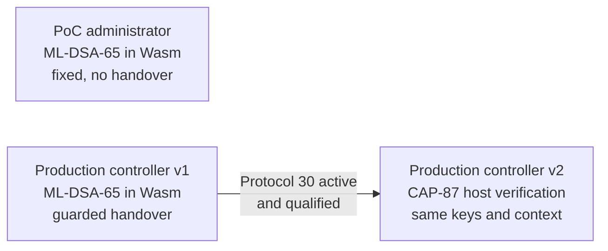

The PoC administrator has no migration path; production controllers do.

Target configuration contains passphrase/SHA-256 network ID, endpoints, accepted
protocol range, deployment generation, contract IDs/executable hashes, ABI/schema
versions and provenance. URL is not network identity. Compare live network,
constructor state and code with the approved release manifest before signing.
Private networks require their own passphrase/manifests.

Testnet reset clears state/history. Passphrase alone does not distinguish
generations: retain a generation ID plus ledger/deployment anchors. Halt on
backward history or missing anchors; invalidate caches, pending transactions,
checkpoints and assessments. Recreate disposable fixtures with a new manifest;
preserve old identities as historical evidence. See the
[network guide](https://developers.stellar.org/docs/networks) and
[reset procedure](OPERATIONS.md#deployment-and-reset-procedure).

## 9. Transaction and wallet protocol

The source supplies sequence/envelope authority; an operation source may differ.
A fee-bump payer supplies fee authority. Each contract authorizer supplies its
own consent subject to source-account/direct-invoker rules. A connected wallet
or sponsor is not automatically a contract approver.

```mermaid
sequenceDiagram
  participant Client
  participant RPC
  participant Approver
  participant Source
  participant Ledger
  Client->>RPC: Check identity and sequence; recording simulation
  RPC-->>Client: Auth requests, footprint and resources
  Client->>Client: Validate intent, scope, epochs and bounds
  Client->>Approver: Display and sign exact auth preimage
  Approver-->>Client: Credential
  Client->>RPC: Enforced simulation with credentials
  RPC-->>Client: Result, resources and restore requirements
  Client->>Source: Sign assembled bounded envelope
  Source-->>Client: Signed XDR
  Client->>Client: Journal XDR, hashes and intent before sending
  Client->>RPC: sendTransaction
  RPC->>Ledger: Deliver candidate
  Client->>RPC: Poll result and verify effects
  RPC-->>Client: Included result or unresolved status
```

Recording simulation discovers authorization without proving it. Enforced
simulation checks credentials and estimates resources but reserves no state,
sequence, fee or success. Use its footprint, resource data and restoration
information with qualified capped headroom. Decode contract return values as well
as transaction status. See [simulateTransaction](https://developers.stellar.org/docs/data/apis/rpc/api-reference/methods/simulateTransaction).

Build preimages from the actual credential variant with an official compatible
SDK helper. The retained PoC constructs legacy `ADDRESS` payloads and does not
support newer variants. [CAP-71-02](https://github.com/stellar/stellar-protocol/blob/master/core/cap-0071-02.md)
(Final, protocol 27) adds `SOROBAN_CREDENTIALS_ADDRESS_V2`, whose preimage includes
the authorizer address. Legacy payloads do not include it; do not generalize
shared-key safety from them. Address-bound credentials are available on current
networks, so every production controller **requires** them and uses separate keys
per controller. Legacy credentials remain valid for now but may be deprecated in
a later protocol. Delegated credentials (CAP-71-01) need their own explicit
compatibility tests.

Auth/invocation changes require fresh approval; sequence/fee changes require
envelope re-signing. Resimulation must preserve approved auth bytes or restart
approval. Time bounds and authorization ledger expiry are independent. Large
resource fees require checked int64 handling; CAP-66's fee-bump path is already
used by the PoC when the inner uint32 fee cannot represent the estimate.

[sendTransaction](https://developers.stellar.org/docs/data/apis/rpc/api-reference/methods/sendTransaction)
queues candidates; `PENDING`/`DUPLICATE` is not inclusion. Pre-inclusion rejection
is not an included failed transaction. Fetch the final result and effects.
Ledger inclusion has finality under [SCP safety assumptions](https://developers.stellar.org/docs/learn/fundamentals/stellar-consensus-protocol);
provider honesty remains separate. Do not invent confirmation-depth requirements.

Timeout is `UNKNOWN`. Journal exact XDR, intent and inner/outer hashes before
sending; retry identical envelopes with bounded backoff. Reconcile receipt,
source sequence and business state before rebuilding. `NOT_FOUND` can mean not
yet seen or outside retention. New sequence/auth nonce can repeat a successful
economic action; database idempotency alone cannot prevent it. Target treasury
controllers consume signed intent nonces on-chain. Current APIs have no generic
business idempotency key. Never automatically resubmit an ambiguous mutation with
fresh approval. [Client/service details](CLIENTS_AND_SERVICES.md#transaction-state-machine)
define statuses and recovery.

## 10. Storage and resource lifecycle

Registry tenant/role entries are persistent; registrar is instance data.
`keep_alive` extends live tenant/roles. Several reads/writes extend tenant/instance
TTL, but role getters and score reads do not retain role TTL. Fixed admin extends
instance on construction and valid authentication. Both target
`min(120_960, max_ttl)` with a half-target threshold: approximately seven days at
five seconds per ledger, not an SLA. Counter/seed contracts have no extension
method. Mailbox uses temporary entries; logical expiry can precede deletion.

Persistent/instance entries archive and can restore; temporary entries expire
permanently. Instance and executable lifetimes both matter. Extending one
contract does not retain external dependencies. Protocol23+ invocation restore
lists can restore archived state before execution when simulation supplies the
needed entries; incomplete lists fail. Explicit `RestoreFootprint` is a fallback,
followed by fresh simulation/approval. Extension cannot revive archived state.
See [archival guidance](https://developers.stellar.org/docs/learn/fundamentals/contract-development/storage/state-archival)
and [CAP-66](https://github.com/stellar/stellar-protocol/blob/master/core/cap-0066.md).

The target dependency catalog includes instances, executables, every tenant/role
entry, external verifier/configuration, relevant token balances/allowances, and
proof preprocessing if ever enabled. Keepers inspect ledger TTL, lease bounded
jobs, simulate extension/restoration, enforce XLM budgets and confirm effects.
Others may perform permissionless maintenance. Restore original authority;
archival must not reset epochs or permit silent re-enrollment.

Refresh code/envelope/entry/event size, CPU, memory, read/write and rent settings
for every qualified deployment. Live-memory and disk/restored reads differ.
The October partial Testnet snapshot's 131,072-byte code, 132,096-byte transaction,
400M instructions and 40 MiB memory are historical values. Native tests and
overridden host limits do not establish admission. Qualify complete transactions,
including multiple credentials, restore costs, dependencies and hostile inputs.

## 11. dApp, SDK and durable services

Target dApp journeys are discovery, graph/declaration comparison, evidence export,
guarded editing, holder authorization and later supported treasury operations.
Recovery stays unavailable until its separate gates pass. Show exact issuer,
SAC, key, network, operation, amount, payer, scope and observation age before
signing. Unknown/stale data cannot carry a verified badge. Keyboard/screen-reader
access, non-color statuses and reload/reconnect recovery are release requirements.

The target SDK separates exact-value codecs, version-pinned generated bindings,
manifest validation, wallet adapters, transaction orchestration and assessment
verification. Browser packages exclude native secret-file tools and proving
backends. No published package or runnable new SDK API is claimed.
[Clients and services](CLIENTS_AND_SERVICES.md) specifies proposed interfaces,
errors, schemas and compatibility.

An indexer is required for completed monitoring/history, though the finite PoC
uses JSON/live reads. Contracts cannot enumerate all tenants and ordinary RPC
history is bounded. Index raw ledger metadata, events/classic effects, resulting
configurations and assessments; events signal changes, reconciliation establishes
state. Detect changes without Q-Asset events too. The index never signs approvals.

[getEvents](https://developers.stellar.org/docs/data/apis/rpc/api-reference/methods/getEvents)
provides retained ranges and opaque cursors; default history is ledger-denominated,
not seven guaranteed days. [Data-lake-backed getLedgers](https://stellar.org/blog/developers/rpc-now-with-infinite-scroll)
can supply older metadata only where a provider retains it; that does not extend
all endpoints. Target schemas, event identity, checkpoints, replay/gaps and freshness
are specified in the client/service reference.

## 12. External integrations and confidentiality

| Integration | Supplies | Does not establish |
| --- | --- | --- |
| RPC | Simulation, entries, delivery and retained receipts/events | Honest server, perpetual history or inclusion guarantee |
| Horizon | Classic account/trustline/operation views | Atomic cross-service snapshot or arbitrary contract semantics |
| SEP-41/SAC | Token interface/native asset bridge | Honest arbitrary token economics or issuer retirement |
| Wallet | Selected envelope/auth signing capabilities | ML-DSA availability or correct dApp intent |
| SEP-5 | Supported HD derivation | Entropy, ownership or safe recovery |
| Optional SEP-1 metadata | Issuer descriptions/domains | Endorsement, reserves or verified authority |
| Optional custody/KMS | Selected supported signing boundary | Correct ML-DSA context or independent approval factors |

Fetch metadata through bounded HTTPS retrieval with redirect/private-address
protections. Sanitize text/URLs, restrict images and disallow active HTML/SVG.
Metadata cannot select executable code or change asset identity. Never fetch
assessment-supplied URLs on signer hosts. Optional web login (SEP-10/SEP-45)
requires separate versioned implementation; it grants no transaction consent.
Anchors, KYC, prices, bridges and redemption APIs are optional issuer integrations,
not current or necessary dependencies.

Only public chain state and approved public evidence enter the public archive.
Customer annotations belong in a separately encrypted, tenant-isolated service
with access logs and deletion/retention rules. Telemetry excludes credentials,
secrets, pending signed transactions and private annotations. Research scalar
proofs can themselves disclose secrets. Public-fixture workflows must not become
production witness-upload flows. Deleting logs cannot undo chain publication.

## 13. Threats and operations

| Failure/adversary | Required control | Boundary |
| --- | --- | --- |
| False labels/incomplete graphs | Explicit provenance, supported adapters, unknown edges | Operator/key independence needs separate evidence |
| Classic issuer or upgrade bypass | Enumerate alternate powers and verify migration | Scoped success is not global protection |
| Cached old-key auth | Restricted current scope; target operation-time epochs | General mutable/batched auth remains unqualified |
| Compromised API/relay | Exact intent display, signer allowlists, on-chain binding, fee caps | Availability/presentation still at risk |
| Edited evidence/dishonest provider | Raw XDR/credential/ledger-order checks; compare sources | Consistency is not validator-authenticated state |
| Replay/concurrent mutation | Host nonce/expiry; guarded revisions or target nonce consumption | Unconditional setters remain available |
| Resource/TTL abuse | Bounded input/graph/queue/footprint and budgets | Large proofs are not production inputs |
| Key loss/compromise | Approved custody, drills, explicit rotation/immutability | Current fixed admin cannot recover/rotate |
| Outage/gap/reset | Durable journal/archive, replay and generation isolation | Missing historical negatives cannot be recreated retroactively |

The [prototype threat model](THREAT_MODEL.md), [PoC threat model](POC_THREAT_MODEL.md)
and [security policy](../SECURITY.md) define concrete boundaries and reporting.
[Operations](OPERATIONS.md) defines metrics, containment, restore drills and
releases. No hidden pause key exists. Disabling a website/relay does not disable
on-chain calls. A compromised immutable operator key has no administrative
software repair; issuer-specific asset migration may be necessary.

## 14. Delivery, testing and production gates

| Stage | Required dependencies and acceptance evidence |
| --- | --- |
| Reproducible core | Exported sources, pinned builds, regressions, evidence consistency; preserve identities |
| Protocol compatibility | Updated decoder/SDK, credential/address variants, fresh limits and restored-state simulation |
| Expanded adapters | Complete explicit authority paths, supported/unknown cases, hostile configuration and drift tests |
| Read-only product | Durable ingestion/replay/gap detection, reconciled API, accessible inspection and SDK packaging |
| Scoped writes | Isolated signing, enforced simulation, outcome journal, funding caps and reconnect recovery |
| Production controller | New code, epoch/nonce enforcement, migration/incident drills, independent review |
| Production service | Assigned owners, licensing/hosting controls, measured objectives, provenance and deployment acceptance |
| Optional seed recovery | Reviewed quantum knowledge/privacy, feasible verifier and complete retirement/recovery lifecycle |

Tests must exercise actual host authorization, weighted predicates, conservation,
cache/recovery attacks, rollback, overflow, archival/restoration, nonce/expiry,
network/argument/domain binding and malformed inputs. Service coverage includes
duplicate/out-of-order ingestion, incomplete pages, retention gaps, checkpoint
crashes, database migration, reset, concurrent submission, lost responses and
browser reconnect. Cryptographic tests run NIST ACVP and Wycheproof ML-DSA vectors,
including malformed encodings, on every verification path, and evidence checks use
a second ML-DSA implementation. Classical-coalition results must match a
brute-force oracle on generated policies. Cross-implementation checks are internal
execution, not an independent external audit.

Initial release mapping:

| Release stage | Architecture stages covered |
| --- | --- |
| 1. Reusable assessment | Reproducible core, protocol compatibility, expanded issuer/SAC adapters, classical-coalition engine and legacy-Ed25519 threshold check |
| 2. Policy management and controller on Testnet | Read-only product services, registry version with revision-checked handover and report receipts, SDK, monitoring, guarded-handover ML-DSA controller with address-bound credentials and rotation tests |
| 3. Qualified production release | Production service acceptance, reviewed controller deployment and CAP-87 verification where Protocol 30 is active |

Treasury adapters beyond the reference configuration, a generic treasury
controller and seed recovery are outside the initial release.

Qualification records exact source/artifacts, protocol/cost model/settings and
workloads. Measure complete valid/hostile transactions, worst-case key counts,
restore costs, RPC rates, replay throughput and web latency. Select cost and
service budgets from real requirements and measurements; native research timings
are not production guarantees. Resource exhaustion is failed execution, not
cryptographic rejection.

Unresolved decisions: actual owners/release keys and repository license, supported
issuer/treasury adapters and classic-state trust, controller quorums/lifecycle,
native-verifier migration, wallet/KMS capability, hosting/history retention,
service objectives and SDK publication. Each needs an owner, decision record and
acceptance evidence before enabling the dependent capability. Assessment and
scoped enforcement can ship independently of legacy-recovery research success.
