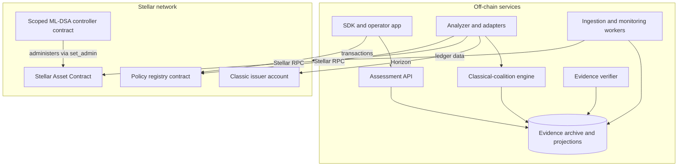
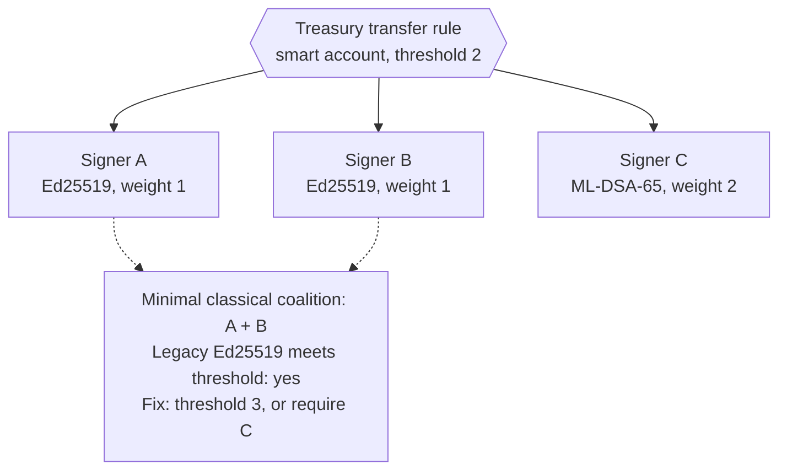
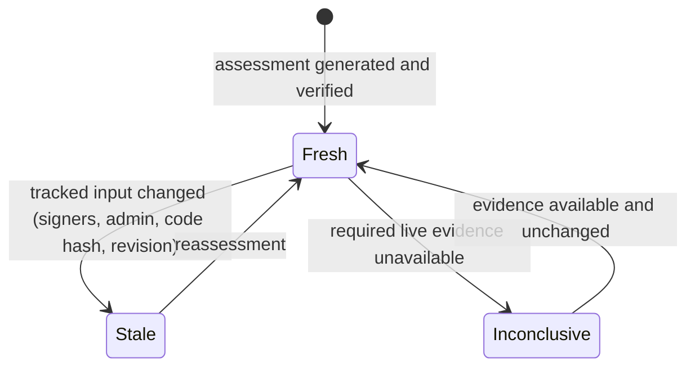
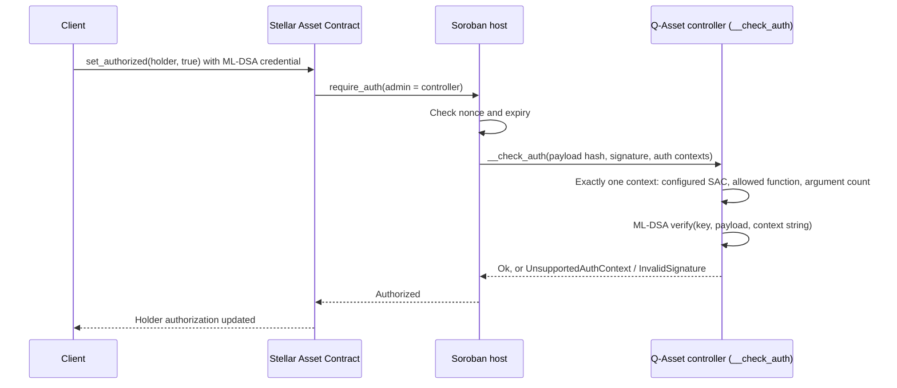
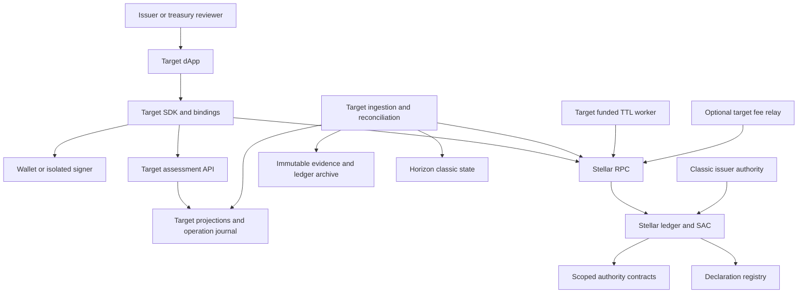
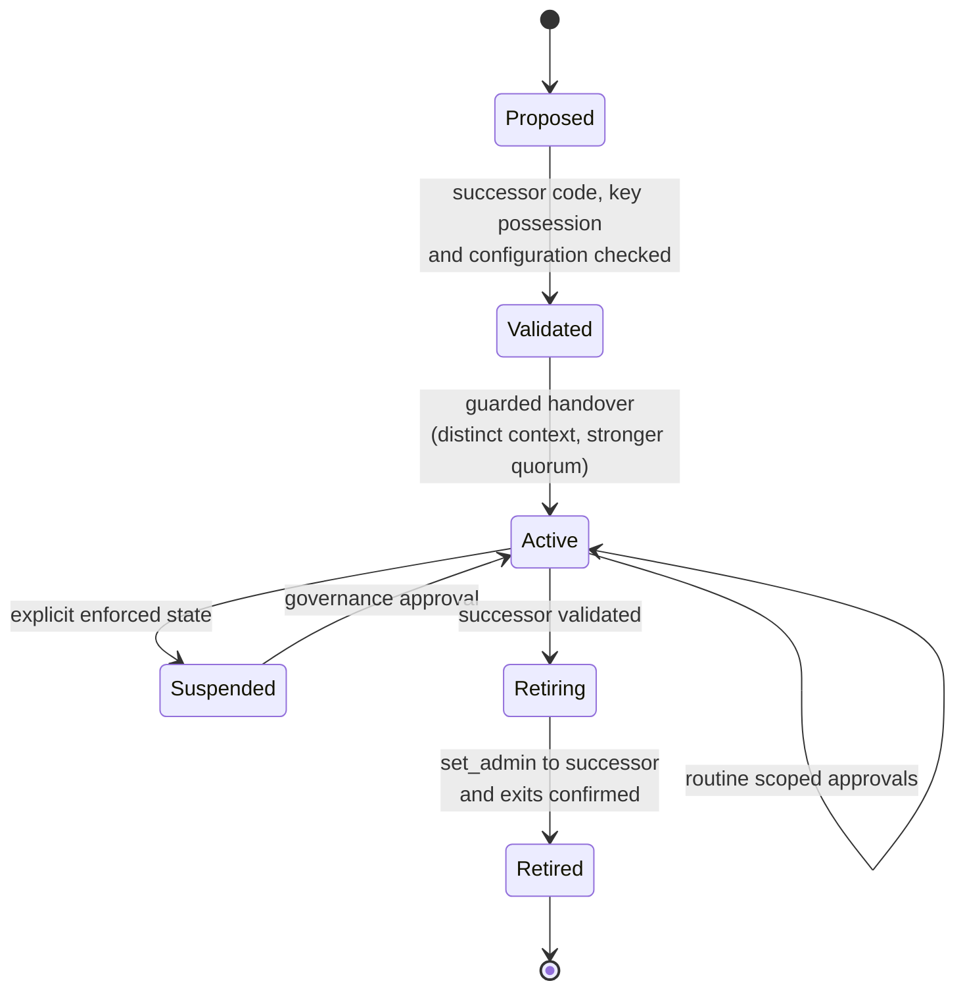
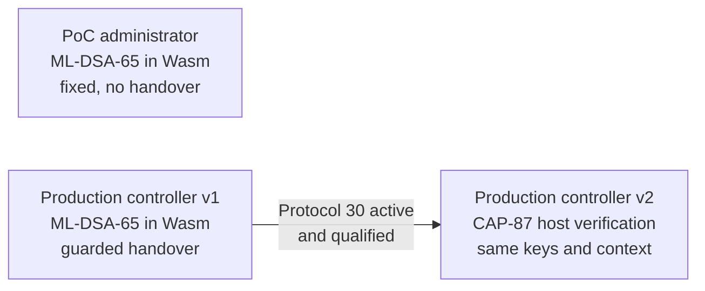

# Q-Asset technical architecture

Design baseline: 2026-11-05; revised 2026-11-07 after an architecture and
cryptography audit. This is the primary architecture for the completed product.
The proof of concept (PoC) is evidence that core mechanisms work; it is not the
product. **Current** describes checked-in code or dated evidence; **target**
specifies work still required. Target requirements are not deployed capabilities.
No production deployment or independent external security approval is established.

Supporting specifications: [contracts](CONTRACTS.md), [clients and services](CLIENTS_AND_SERVICES.md),
[operations and releases](OPERATIONS.md), [decisions](DECISIONS.md), and
[maintenance](MAINTENANCE.md). The [authority demonstration](POC_ARCHITECTURE.md)
explains the implemented integration; [recovery status](RECOVERY_IMPLEMENTATION_STATUS.md)
bounds the research. Findings and validation belong in the separate
[documentation review](ARCHITECTURE_REVIEW.md). Part I presents the product; Part II
holds the detailed specifications.

## Contents and section summaries

**Part I — Product architecture** ([overview](#part-i--product-architecture))

| Section | Summary |
| --- | --- |
| [A. What Q-Asset is](#a-what-q-asset-is) | The problem of independent authority layers on Stellar, the question Q-Asset answers, its five capabilities and design principles |
| [B. How Q-Asset works end to end](#b-how-q-asset-works-end-to-end) | The assess → declare → enforce → monitor workflow, with a sequence diagram |
| [C. System components](#c-system-components) | On-chain and off-chain components, their technology, responsibilities and PoC status |
| [D. Authority model and classical-coalition analysis](#d-authority-model-and-classical-coalition-analysis) | Graph node and edge types, protected operations and thresholds, and the minimal classical-coalition algorithm |
| [E. Assessments and evidence](#e-assessments-and-evidence) | Status model, evidence bundle structure, path catalogue, verifier and freshness lifecycle |
| [F. Policy registry](#f-policy-registry) | Tenant and quorum data model, revision-checked writes and the target receipt design |
| [G. Scoped ML-DSA controllers](#g-scoped-ml-dsa-controllers) | Authorization flow through `__check_auth`, payload binding, and PoC versus production controller properties |
| [H. SDK, API and monitoring](#h-sdk-api-and-monitoring) | SDK modules, read API endpoints and the monitoring pipeline |
| [I. Measured PoC results](#i-measured-poc-results) | Contract sizes, signature sizes, instruction and fee costs, Testnet results and freshness evidence |
| [J. Security model](#j-security-model) | Trust boundaries, what each guarantees and what it still depends on |

**Part II — Detailed specifications** ([overview](#part-ii--detailed-specifications))

| Section | Summary |
| --- | --- |
| [1. Product, requirements and economics](#1-product-requirements-and-economics) | User workflows, absence of any token or protocol fee, cost sources and requirements |
| [2. Implementation boundary and topology](#2-implementation-boundary-and-topology) | Current versus target per component and the target hosting topology |
| [3. Identity, authority graphs and evidence](#3-identity-authority-graphs-and-evidence) | Asset identity, graph traversal bounds, path statuses and read consistency |
| [4. Declared policy contract](#4-declared-policy-contract) | Registry consent rules, revisions and the exact QS0–QS4 declaration predicates |
| [5. Assets, custody and accounting](#5-assets-custody-and-accounting) | SAC operations and their authority, issuer residual powers, precision and conservation |
| [6. Enforcement and lifecycle](#6-enforcement-and-lifecycle) | Current administrator, production controller, guarded handover, lifecycle states, cryptographic parameters and verified gates |
| [7. Conditional recovery extension](#7-conditional-recovery-extension) | Enrolled-key counter, disabled seed account, target recovery statement and open gates |
| [8. Network configuration and deployment provenance](#8-network-configuration-and-deployment-provenance) | Pinned versions, Protocol 30 status, CAP-87 compatibility and migration, network identity and resets |
| [9. Transaction and wallet protocol](#9-transaction-and-wallet-protocol) | Source, fee and contract authority, simulation, address-bound credentials and outcome handling |
| [10. Storage and resource lifecycle](#10-storage-and-resource-lifecycle) | TTL rules, archival and restoration, dependency maintenance and resource limits |
| [11. dApp, SDK and durable services](#11-dapp-sdk-and-durable-services) | Target user journeys, SDK separation, indexing and history retention |
| [12. External integrations and confidentiality](#12-external-integrations-and-confidentiality) | What RPC, Horizon, wallets, SEP-5, metadata and custody do and do not establish |
| [13. Threats and operations](#13-threats-and-operations) | Adversaries, required controls and residual boundaries |
| [14. Delivery, testing and production gates](#14-delivery-testing-and-production-gates) | Delivery stages, test requirements, release mapping and unresolved decisions |

## Part I — Product architecture

Part I presents the product and how each component works. Part II holds the
detailed specifications, constraints and operating rules that Part I relies on.

### A. What Q-Asset is

A Stellar asset is controlled through several independent layers: the classic
issuer account with its own signers, weights, thresholds and flags; the Stellar
Asset Contract (SAC) and its administrator; and, for many products, smart
accounts, upgradeable contracts, governance and recovery arrangements. Changing
one layer does not change the others. An issuer can move SAC administration to a
post-quantum-protected account while its classic key can still issue tokens with
a native Payment.

Q-Asset answers, for each asset and treasury, the question that matters during
post-quantum migration: **which classical keys can still exercise each critical
power, and has that changed since the last check?** It then helps move the
powers that can be delegated to operation-scoped ML-DSA approval, and keeps the
evidence current.

| Capability | What the user gets |
| --- | --- |
| Assess | A per-asset authority graph and, for each protected operation, the minimal sets of classical signers that can still exercise it |
| Declare | A shared, revision-checked record of the intended policy that can be compared with observed authority |
| Enforce | Operation-scoped ML-DSA approval for delegable operations, with guarded handover and rotation |
| Monitor | Reassessment when tracked authority changes, with affected results marked stale |
| Prove | Reproducible evidence bundles that an independent reviewer can verify |

Design principles:

* **The asset is the unit of analysis**, not a wallet or a single signature.
* **Observed authority outranks declarations.** A declared policy is compared
  with what the ledger and code actually allow; it never upgrades itself.
* **Fail closed.** Unsupported code, signer kinds or missing data produce
  `UNCOVERED` or `INCONCLUSIVE`, never a favorable result.
* **Scope enforcement to operations.** A valid signature for one operation cannot
  authorize another.
* **Evidence expires.** Results are bound to the configuration they observed.

### B. How Q-Asset works end to end

```mermaid
sequenceDiagram
  participant Issuer as Issuer team
  participant App as Q-Asset SDK / app
  participant Analyzer as Analyzer and coalition engine
  participant Ledger as Stellar (Horizon, RPC)
  participant Registry as Policy registry
  participant Controller as Scoped ML-DSA controller
  Issuer->>App: Asset identity and intended roles
  App->>Analyzer: Request assessment
  Analyzer->>Ledger: Read issuer signers, thresholds, flags, SAC admin, contract code
  Analyzer->>Ledger: Enforced simulations of protected operations
  Analyzer-->>App: Authority graph, classical coalitions, evidence bundle
  Issuer->>Registry: Declare intended policy (revision-checked)
  Issuer->>Ledger: set_admin: delegate SAC administration
  Ledger->>Controller: Delegated operations require ML-DSA approval
  Ledger-->>Analyzer: Tracked configuration changes
  Analyzer-->>App: Affected results marked stale; reassessment
```

1. **Discover and assess.** The analyzer reads the asset's authority layers,
   builds its graph, computes classical coalitions per operation and exercises
   permitted and forbidden operations in enforced simulation.
2. **Declare.** The issuer records the intended roles, signer weights and
   thresholds in the registry; the assessment compares declaration and reality.
3. **Enforce where delegable.** SAC administration and supported contract powers
   move to a scoped ML-DSA controller. Classic issuer powers are reported until
   the issuer separately restricts them.
4. **Monitor.** Tracked changes mark affected evidence stale and trigger a new
   assessment before a report is reused.

### C. System components



| Component | Technology | Responsibility | PoC status |
| --- | --- | --- | --- |
| Policy registry | Rust, Soroban | Declared roles, weights, thresholds, revisions, events | Deployed on Testnet; 28,553-byte Wasm |
| Scoped ML-DSA controller | Rust, Soroban custom account | Operation-scoped ML-DSA approval of delegated SAC and contract operations | Fixed single-operation administrator; 59,167-byte Wasm |
| Analyzer and adapters | Off-chain service | Reads authority layers, builds graphs, classifies paths | Python analyzer for two reference assets |
| Classical-coalition engine | Off-chain library | Minimal classical coalitions per operation | Specified in §D; not yet implemented |
| Evidence verifier | Off-chain tool | Recomputes classifications and checks live configuration | Separate Python verifier with exit codes |
| Ingestion and monitoring | Off-chain workers | Change detection, reassessment, alerts, TTL maintenance | Target |
| SDK, API, operator app | TypeScript, HTTP | Inspection, policy editing, evidence export | Target; interfaces in [clients and services](CLIENTS_AND_SERVICES.md) |
| Recovery research | Rust, Soroban, proof systems | Optional, gated extension (§7) | Enrolled-key counter, disabled seed account, proof mailbox |

### D. Authority model and classical-coalition analysis

The analyzer represents each asset as a typed, directed authority graph.

| Node type | Examples | Key attributes |
| --- | --- | --- |
| Asset identity | Issued asset (code, issuer), its derived SAC address | Network, flags (`AUTH_REQUIRED`, `AUTH_REVOCABLE`, `AUTH_CLAWBACK_ENABLED`, `AUTH_IMMUTABLE`) |
| Classic account | Issuer, treasury, registrar | Signers, master weight, low/medium/high thresholds |
| Signer | Ed25519 key, signed payload, pre-authorized transaction, hash(x), ML-DSA key | Kind, weight, classical or post-quantum |
| Contract account | Q-Asset controller, supported smart accounts | Recognized code hash, extracted quorum and allowlist |
| Contract authority | SAC administrator, upgrade authority, governance | Holder address, operations it can perform |

| Edge | Meaning |
| --- | --- |
| `signs_for(weight)` | A signer contributes weight to an account or contract rule |
| `administers` | A holder can invoke administrative functions of a contract |
| `authorizes(operation)` | A node can authorize a protected operation |
| `upgrades` / `replaces` | A node can change code or the authority above it |

Protected operations and the threshold that governs them:

| Layer | Operation | Governing rule |
| --- | --- | --- |
| Classic issuer | Payment from the issuer (issuance) | Medium threshold |
| Classic issuer | `SetTrustLineFlags` / `AllowTrust` (holder authorization) | Low threshold |
| Classic issuer | `Clawback` (if clawback is enabled) | Medium threshold |
| Classic issuer | `SetOptions` changing signers or thresholds | High threshold |
| SAC | `mint`, `clawback`, `set_authorized`, `set_admin` | The SAC administrator's authorization |
| Contracts | Upgrade, governance, treasury transfer | The contract's own rule, from a supported adapter |

For each protected operation, the **classical-coalition engine** computes the
minimal sets of classical authorities that satisfy its rule without any
post-quantum participant. A coalition is minimal when removing any member breaks
it. Ed25519 keys, signed-payload signers and secp256r1 smart-account signers are
classical; pre-authorized-transaction and hash(x) signers are reported as
non-key authorities; ML-DSA signers count as post-quantum only where enforcement
is established.

```text
coalitions(node, op):
  if node is unsupported or unknown:          return UNCOVERED
  T  := threshold(node, op)
  C  := classical members of node, sorted by weight (descending)
  out := []
  search(i, chosen, w):
    if w >= T:                                 # rule satisfied
      if no proper subset of chosen meets T:   # minimality
        out.append(chosen)
      return
    if i == len(C) or w + remaining_weight(i) < T:
      return                                   # bound: cannot reach T
    search(i+1, chosen + [C[i]], w + weight(C[i]))
    search(i+1, chosen, w)
  search(0, [], 0)
  expand members that are contract or account nodes by their own coalitions,
  within node and coalition ceilings; an exceeded ceiling returns UNCOVERED
  return out
```

A classic account has at most 20 signers plus its master key, so a per-account
search is bounded by 2^21 subsets before pruning. The engine reports, per
operation: the minimal coalitions and their sizes, whether a classical-only path
exists, and whether legacy Ed25519 signers alone still meet the threshold after
post-quantum signers are added. Results are validated against a brute-force
subset oracle on generated policies.



### E. Assessments and evidence

Every protected path receives one status.

| Status | Meaning |
| --- | --- |
| `EXPOSED` | Supported configuration or a successful execution shows usable classical authority |
| `TESTED_PASS` | The cited authorized operation succeeded |
| `TESTED_REJECT` | The cited operation or credential was rejected under documented conditions |
| `DECLARED` | A policy is recorded without established enforcement |
| `UNCOVERED` | No established protection, or the path is outside supported adapters |
| `STALE` | A tracked input changed after the assessment |
| `INCONCLUSIVE` | Required live evidence is unavailable |

An evidence bundle (current schema `qasset-authority-assessment-v2`) contains:
the network and passphrase; the observed ledger range; tool name, version and
source hashes; per-asset identity (SAC, issuer, holder, administrator), issuer
signers, thresholds and flags, administrator Wasm hash and policy revision; the
cryptographic mechanism; hashes of every input file; the classified paths; stated
limitations; and a SHA-256 digest of the canonical body. Each path records its
asset, path identifier, status, explanation and citations of recorded
transactions or simulations, for example:

```json
{ "asset": "QEXP", "path": "issuer.classic_mint", "status": "EXPOSED",
  "detail": "Classic issuer Payment succeeded after SAC handover.",
  "citations": [ { "observation_id": "…", "kind": "transaction", "hash": "…" } ] }
```

The current reference assessment classifies 16 paths per asset across issuer
(`issuer.classic_signers`, `issuer.classic_mint`, `issuer.trustline_flags`), SAC
(`sac.admin`, `sac.set_authorized`, `sac.mint`, `sac.clawback`, `sac.set_admin`),
administrator (`admin.upgrade`), credential (`auth.corrupted_signature`,
`auth.wrong_network_signature`, `auth.replayed_entry`), transaction
(`transaction.source_and_fee_payer`) and registry (`registry.admin`,
`registry.policy`, `registry.revision_conflict`) layers.

The verifier is a separate implementation. It recomputes classifications from
raw XDR and recorded responses, checks ML-DSA credentials and the exact negative
mutations, and in live mode rechecks receipts, executable hashes, issuer signers,
thresholds and flags, SAC administrator, operator key, quorums and registry
revision. Exit 0 means `SUCCESS`, exit 1 `STALE` or `INVALID`, exit 2
`INCONCLUSIVE`. Target additions: coalition results per operation, registry
report receipts and signed attestations with an explicit trust model.



### F. Policy registry

The registry is a shared, revision-checked record of declared policy. It is
multi-tenant: each asset label has its own tenant administrator.

| Record | Fields | Notes |
| --- | --- | --- |
| Tenant | `admin`, `revision: u64` | Created by registrar plus tenant consent; revision starts at 0 |
| Role quorum | `signers: [ { address, algo, weight } ]`, `threshold` | Eight roles: Mint, Burn, Freeze, Clawback, Treasury, Upgrade, Governance, Recovery |
| Events | `QuorumSet`, `AssetAdminChanged` | Carry the new revision |

Writes use compare-and-set on the revision: `set_role_quorum_if_revision`
applies a change only if the caller's expected revision is current, otherwise it
fails with error 15 and changes nothing. Quorums hold at most 20 unique
addresses with weights 1–255 and a reachable non-zero threshold. Declared QS0–QS4
levels are computed from these declarations ([§4](#qs0qs4-standard)); the
verified-gate APIs always fail because a declaration is not enforcement.

Target registry version: expected revisions on every mutation including tenant
handover, no unconditional setter, a conventional Stellar multisignature account
as registrar, and bounded **report receipts** that bind publisher, network,
tenant, asset identity, policy revision, schema and tool versions, observation
interval and expiry. A receipt states what was published, not that the
publisher discovered all authority.

### G. Scoped ML-DSA controllers

When an issuer calls the SAC's `set_admin` with a Q-Asset controller as the new
administrator, every SAC administrative call requires that controller's
authorization, and the Soroban host invokes its `__check_auth`.



The payload is the host's SHA-256 digest of the authorization preimage, which
binds the network ID, nonce, signature expiration ledger and the exact invocation
tree, including argument values. The controller adds the ML-DSA domain context
`qasset-sac-admin-auth-v1`. It checks the authorization context **before**
verifying the signature, so other functions, other SACs, contract creation and
composite trees are rejected without cryptographic work. It has no outgoing
call into the SAC, so it can never act as an automatically authorized direct
invoker.

| Property | PoC administrator | Production controller (target) |
| --- | --- | --- |
| Allowed operations | `set_authorized` on one SAC | Configured allowlist of contract, function and argument constraints |
| Keys | One ML-DSA-65 key (1,952-byte public key, 3,309-byte signature) | Quorum of ML-DSA keys, optional classical AND post-quantum rules |
| Handover and rotation | None (deliberate) | Guarded `set_admin` handover and key rotation (§6) |
| Credentials | Legacy address credentials | Address-bound credentials only (§9) |
| Verification | RustCrypto `ml-dsa` 0.1.1 inside Wasm | Wasm, then CAP-87 host functions when Protocol 30 is active (§8) |
| Cost | About 102.5 million instructions and about 59,000 stroops resource fee per authorized call | Measured per release |

A rule that accepts classical **or** post-quantum approval keeps a classical
route; a rule that requires both changes availability. The controller records
which rule applies to each operation, and the coalition engine evaluates it.

### H. SDK, API and monitoring

The SDK separates `core` (identities, exact amounts, evidence codecs),
`bindings` (generated from pinned Wasm), `network`, `transactions`, `wallets` and
`assessments` modules. The assessment API serves versioned, read-only resources:

```text
GET /v1/networks/{generation}/assets/{identity}/authority
GET /v1/networks/{generation}/assets/{identity}/assessments?cursor=...
GET /v1/assessments/{evidenceHash}
GET /v1/operations/{operationId}
GET /v1/health
```

Every response carries the network generation, schema and adapter versions,
indexed and reconciled ledgers, observation range and freshness state.
Monitoring workers ingest ledger data, detect changes to tracked authority
(signers, thresholds, flags, administrators, code hashes, registry revisions),
mark affected results stale, trigger reassessment and maintain contract TTL.
Indexing data never grants approval authority. Interfaces and the transaction
state machine are specified in [clients and services](CLIENTS_AND_SERVICES.md).

### I. Measured PoC results

| Measurement | Value |
| --- | --- |
| Contracts | Five Rust/Soroban contracts; 90 contract tests, 4 signer tests and 124 Python tests passing |
| Registry Wasm | 28,553 bytes, SHA-256 `26f684ed…a207` |
| SAC administrator Wasm | 59,167 bytes, SHA-256 `f7ed9b81…72b6` |
| ML-DSA-65 sizes | 1,952-byte public key; 3,309-byte signature |
| Authorized `set_authorized` call | About 102.5 million instructions; about 57,900–59,200 stroops estimated resource fee |
| Testnet run | 28 successful transactions, 10 rejected enforced simulations, 1 rejected submission |
| Reference assessment | 32 paths: 5 exposed, 4 tested-pass, 11 tested-reject, 10 uncovered, 2 declared |
| Freshness | A policy revision marked 16 of 32 paths stale; the verifier exited 1 |
| Storage | Instance TTL target 120,960 ledgers, about seven days at five seconds per ledger |

### J. Security model

| Boundary | Guarantee | Residual dependency |
| --- | --- | --- |
| Operation scope | A valid signature authorizes only the allowlisted operation | Allowlist correctness and review |
| Classic issuer | Reported until separately restricted | Issuer key custody and migration |
| Transaction envelopes | Submitters cannot forge or alter the ML-DSA approval | Ed25519 still signs envelopes and pays fees; affects availability |
| Declarations | Never treated as enforcement | Registrar and tenant administrators are trusted for declaration content |
| Evidence | Bound to observed configuration; expires on tracked change | RPC and Horizon providers are trusted for availability and completeness |
| Cryptography | ML-DSA-65 with domain separation; bounded by the SHA-256 digest (§6) | Unaudited implementation until reviewed |

Threats, controls and operations are detailed in §13 and in the
[threat models](THREAT_MODEL.md).

## Part II — Detailed specifications

## 1. Product, requirements and economics

Q-Asset helps issuers, treasury operators, custodians and reviewers identify and
strengthen effective authority over Stellar assets. It combines declared policy
arithmetic, supported authority-path analysis, operation-specific enforcement
and reproducible assessments. Every supported path that can issue assets, move
balances or replace a stronger rule must be examined. Assessments explicitly
identify uncovered paths.

| User | Completed-product workflow | Required outcome |
| --- | --- | --- |
| Issuer administrator | Discover issuer/SAC authority, declare intent, compare and delegate supported operations | Exact identity and visible classic issuer residual powers |
| Treasury operator and approvers | Inspect custody, prepare, approve, execute and reconcile transfers | Exact amount/destination; current policy; no weaker override |
| Security reviewer | Download inputs, reproduce classifications and verify receipts | Versioned evidence, scope and freshness boundaries |
| Operations team | Monitor drift, fund fees, retain TTL and restore | Visible gaps; restoration preserves authority |
| Owner, conditional recovery extension | Enroll/revoke recovery eligibility and replace authority | Current entitlement, replacement possession and one-time consumption |

The repository defines **no Q-Asset token, staking, yield, lending, redemption
price, revenue split, per-assessment charge or protocol fee**. QEXP and QCTL are
synthetic Testnet assets. Reserve backing, beneficial ownership, legal redemption
and compliance decisions belong to issuers/custodians; these contracts do not
establish them. Commercial service pricing is unresolved.

Actual costs are network fees in XLM, classic account/trustline reserves,
Soroban resource/rent/restoration charges, infrastructure and custody. A source
pays transaction fees unless a fee-bump payer covers them; reserve sponsorship
is a different mechanism. The target service funds relay/maintenance accounts
under explicit budgets. Sponsorship gives no asset approval. Funding failure
must never weaken an approval policy.

Requirements and exclusions:

* Scope every result to network, deployment generation, asset and operation.
  Keep declarations, tested observations and unknowns distinct.
* Enumerate issuer, governance, upgrade, recovery, pause, delegation and other
  bypass paths for each supported integration. Eight role labels are not proof
  of complete coverage.
* Keep mnemonic, seed, signing secrets and private customer/compliance data off
  chain. Public evidence should be downloadable and reproducible.
* Treat consensus/host correctness, cryptographic assumptions, key custody and
  provider integrity as separate boundaries. Checksums identify bytes, not truth.
* Do not promise quantum-safe SCP/envelope signatures, arbitrary bytecode
  analysis, retroactive control of classic accounts or automatic regulatory compliance.
* Unsupported code, signer/credential variants and token semantics fail explicitly.

## 2. Implementation boundary and topology

| Component | Current | Target |
| --- | --- | --- |
| `qasset-registry` | Declaration arithmetic, guarded revision writes, events; verified gates unavailable | Preserve declarations; version any verified integration separately |
| `qasset-sac-admin` | Immutable SAC/key; ML-DSA-65 for one direct `set_authorized` auth context | Audited scoped enforcement and separately reviewed lifecycle |
| Analyzer/verifier | Python, two reference configurations, schema v2, raw evidence checks | Versioned adapters, classical-coalition engine, monitoring, archive and API |
| Operator signer | Unix tool, fresh external key file, signs supplied digest | Isolated policy-aware custody service |
| dApp/public SDK | Absent | Inspection, declaration, scoped write, export and recovery flows |
| Indexer/API/relay/keeper | No production service, database or scheduler | Durable history, freshness, bounded delivery and maintenance |
| PQ recovery counter | Local restricted candidate with public fixture keys | Optional independently reviewed account integration |
| Seed verifier/mailbox | Authentication disabled; transport is unverified | Conditional research extension after all acceptance gates |

Current implementation sources: [registry](../contracts/qasset-registry/src/lib.rs),
[administrator](../contracts/qasset-sac-admin/src/lib.rs),
[analyzer](../scripts/qasset_authority_analyzer.py),
[verifier](../scripts/verify_qasset_evidence.py), and
[signer](../tools/qasset-sac-signer/src/main.rs). All five contract packages have
`publish = false`. There are no checked-in CI workflows or production hosting definitions.



Target initial hosting consists of a static web origin, stateless API,
independently restartable ingestion/reconciliation/maintenance workers, a
relational database and immutable blob storage. Database job leases and an outbox
suffice initially; no message broker is required. Provider, redundancy and service
objectives require deployment qualification. Isolate networks and credentials.
The API holds no user approval keys. Signer processes and optional relay envelope
keys have separate identities and funding boundaries. An API compromise may
mislead or withhold information; signing and enforcement still bind the exact action.

## 3. Identity, authority graphs and evidence

The registry's `asset: Address` is a tenant label. Issued-asset identity comprises
network, exact code bytes and issuer; derive the SAC address with the official
SDK. XLM has a native identity; contract tokens use their network and contract
ID. Tickers, domains, logos and enrollment do not establish identity or control.

Target authority graphs have typed account, contract, key, quorum and policy
nodes and directed operation/replacement edges. Each adapter pins recognized
code, ABI, protocol range, signer formats, completeness assumptions and unsupported
cases. Traverse with visited-node detection and qualified depth/node/edge ceilings;
cycles or exhausted bounds produce `UNCOVERED`, never assumed protection. Code
identity alone does not prove policy correctness or independent key custody.

### Classical-coalition analysis

The algorithm, signer classification, bounds and an example are specified in
[Part I §D](#d-authority-model-and-classical-coalition-analysis). Current status: not
implemented. The registry evaluates only the declared predicate `C >= T` per role,
and the PoC analyzer compares summed Ed25519 weight with the medium threshold for
two reference configurations.

Current path statuses are `DECLARED`, `TESTED_PASS`, `TESTED_REJECT`, `EXPOSED`,
`UNCOVERED`, `STALE` and `INCONCLUSIVE`. Verifier `INVALID` describes evidence
failure, not a QS level. There is no overall asset safety score. Future signed
attestations must bind evidence hash, adapter/tool versions, network/generation,
ledger range, configuration, scope and expiry, with an approved attester key and
revocation policy. They do not expand the evidence's scope or establish live authority.

Current reads span a ledger interval. Repeating a registry revision detects some
concurrent changes, not an atomic issuer/SAC/registry snapshot. Target ledger
metadata ingestion constructs views at a complete common ledger boundary and
reconciles point reads. APIs expose that watermark and disagreements. Missing or
unsupported dependencies invalidate the affected freshness claim.

## 4. Declared policy contract

The [contract reference](CONTRACTS.md#registry-api) owns exact signatures, storage,
events and errors. A constructor fixes the registrar without requiring its
consent; deployment review must independently verify that address. Enrollment
requires registrar and incoming tenant consent. Transfer requires outgoing and
incoming tenant consent, with no registrar override. No registrar rotation,
deregistration, role deletion or upgrade entry point exists.

Tenants start at revision 0. Accepted quorum writes and tenant-admin transfers
increment checked `u64` revisions, even for unchanged values.
`set_role_quorum_if_revision` rejects a stale expected revision with error 15.
The unconditional setter and admin transfer offer no compare-and-set. The eight
role entries are independently bounded. There is no global tenant enumeration/cap;
the target catalog derives membership from indexed enrollment events.

### QS0–QS4 standard

These are repository-local **declaration predicates**, not an external certification
standard. Let `C` be classical-labelled weight, `P` PQ-labelled weight, `Pmax` the
largest single PQ-labelled weight and `T` the threshold. Missing roles are weak;
present roles are weak if `C >= T`. Highest-impact roles are Treasury, Upgrade
and Governance.

| Level | Exact declared condition |
| --- | --- |
| QS0 | No PQ label anywhere |
| QS1 | A PQ label exists and a highest-impact role is weak |
| QS2 | No highest-impact role is weak, but another role is weak |
| QS3 | All eight roles exist and require PQ-labelled contribution |
| QS4 | QS3 and `C + Pmax < T` for each highest-impact role |

Classical weight 1 plus PQ weight 1 at threshold 2 is QS3 when used for all roles.
Classical weight 1 plus two PQ weights 1 at threshold 3 meets the extra QS4 rule.
Different addresses need not represent independent keys/operators. A nonexistent
authority needs adapter-validated non-applicability; omission is unknown today.

Quorums contain at most 20 unique addresses, each weight 1–255, and
`0 < T <= C + P`. Total weight is at most 5,100. Duplicate checks are quadratic
but bounded; analysis iterates eight bounded roles. These are metadata limits,
not classic Stellar signer limits or production cryptographic capacity.
`policy_assessment` requires enrollment and returns observation ledger, revision,
declared level and `Unverified`. Direct declaration reads can return QS0/missing
roles for an unknown tenant. Both verified APIs return `UnverifiedPolicy`, even
when asked for QS0.

## 5. Assets, custody and accounting

Current Q-Asset contracts hold no escrow or token balance ledger. The SAC
administrator changes holder permissions; it cannot transfer, mint, burn or claw
back. Target integrations retain balances in the token ledger and approvals in
an account/policy controller. A custody contract would require additional audited
accounting and exit rules.

The [SAC specification](https://github.com/stellar/stellar-protocol/blob/master/core/cap-0046-06.md)
distinguishes holder operations from issued-asset administration. XLM's SAC has
no issuer administrator. Inspect issued-asset `AUTH_REQUIRED`, `AUTH_REVOCABLE`,
immutable flags and per-balance/trustline clawback eligibility; new flags do not
establish all historical trustlines' capabilities. Classic holders require
trustlines, authorization, capacity and reserves. Contract balances have storage
lifetimes and are not classic trustlines. For a classic trustline, SAC
`set_authorized(false)` selects authorization to maintain liabilities rather
than deleting offers/pool positions; do not label it an unconditional full freeze.

| Operation | Authority/accounting boundary |
| --- | --- |
| Transfer | Supported ordinary nonissuer holder/spender path; exact debit equals credit |
| Approve / transfer_from | Holder establishes allowance/expiry; spender may use it without fresh holder approval |
| Burn | Holder or approved spender; destroys units |
| Mint | Issued-asset SAC admin, or separate classic issuer issuance path |
| Set authorization | SAC admin; separate issuer trustline operations remain |
| Clawback | Admin/issuer authority and applicable enabled state; destroys units rather than transferring to a wallet |
| Set SAC admin | Current admin consent; independently test new address and configuration before handover |

[SEP-41](https://github.com/stellar/stellar-protocol/blob/master/ecosystem/sep-0041.md)
is an interface, not proof of arbitrary token economics. Allowances are spending
authority, not reservations. Outstanding approvals, native offers/liabilities,
sponsored reserves and custody overrides belong in treasury coverage. Prefer
direct transfer; allowance support needs expiration, revocation and replacement-race handling.

SAC handover leaves classic issuer powers effective unless separately retired.
The [custom-admin guide](https://developers.stellar.org/docs/build/guides/tokens/custom-sac-admin)
warns that locking an issuer before handover can make the handover impossible.
Production retirement needs a reviewed issuer-specific migration and verified
replacement operation before any irreversible step. The disposable lock runner
is not a production migration tool.

### Precision and conservation

SAC amounts have seven decimal places: one unit is `10_000_000` base units.
Use decimal strings at API boundaries and checked integer arithmetic. Reject
negative transfers, excess precision, scientific notation and implicit rounding.
The ABI is `i128`; classic balance/trustline operations also face signed `i64`
limits, liabilities and reserves. Check the destination representation, not just
the wider ABI. Other contract tokens need explicitly supported decimals and
semantics. See [Stellar's examples](https://developers.stellar.org/docs/build/guides/tokens/stellar-asset-contract).

For supported ordinary nonissuer transfers, conservation is
`debit = credit = amount`. Issuer issuance/redemption and explicit mint/burn/
clawback require separate supply-effect classification; a method name alone
does not establish conservation. The SAC has no `total_supply` method, and a
projection of tracked balances is not a global supply or reserve attestation.
[CAP-67](https://github.com/stellar/stellar-protocol/blob/master/core/cap-0067.md)
defines issuer-related mint/burn event semantics for ingestion. Network fees affect the XLM payer
separately. No service fee may silently reduce principal. No percentage/rounding
rule exists in current economics. Reconcile token effects, allowances and fees
independently; a cached balance establishes no spending authority or redemption backing.

## 6. Enforcement and lifecycle

Current `QAssetSacAdmin` fixes a SAC and 1,952-byte ML-DSA-65 key in instance
storage. `__check_auth` admits one contract auth context: configured SAC,
`set_authorized`, two arguments. It verifies a 3,309-byte signature over the host
digest with context `qasset-sac-admin-auth-v1`. The host binds argument values;
the SAC decodes their types. There is no outgoing SAC invocation, rotation,
recovery, upgrade or other administrative method. Constructor decoding establishes
key length, not possession or SAC trustworthiness. Test configuration before handover.

Auth contexts are authorization-relevant contexts, not a view of every
unauthenticated call-stack ancestor. The guard rejects tested composite/nested
authorizations; it is not a universal call-graph verifier. Direct-invoker
authorization is distinct: a controller calling its SAC can authorize as invoker
without running its own `__check_auth`. Any such public dispatch method must
enforce policy itself. See [authorization](https://developers.stellar.org/docs/learn/fundamentals/contract-development/authorization).

### Target production controller

Rotation, weighted approvals, treasury transfer and upgrade support require a
new versioned controller. Bounded configuration includes operations, independent
key identities, verifier/code pins, quorums, policy epoch and explicit governance/
recovery paths. Unsupported inputs have no permissive fallback.

Unlike the PoC administrator, every production controller supports **guarded
administrative handover**: SAC `set_admin` to a successor is authorized under a
distinct ML-DSA domain context, a stronger quorum than routine operations and an
optional timelock, and the successor is validated before activation. Key rotation
and migration to a successor controller, including one using CAP-87 host
verification, therefore never require an impossible handover. Controllers accept
only address-bound credentials (§9). See
[ADR-008](DECISIONS.md#adr-008-production-controllers-support-guarded-handover-and-address-bound-credentials).



A target treasury `execute` intent binds network, controller, token, operation,
destination, exact amount, expected epoch, nonce and expiry. The execution method
checks current epoch after authorization and immediately before dispatch, and
consumes an intent nonce atomically with effects. Callbacks/subsequent actions
must recheck authority across policy mutations. Governance increments checked
epochs. Batching remains disabled until the cache and execution model passes
independent validation. All direct-invoker paths require equivalent checks.

Initially retain immutable scopes for direct SAC authentication. A dynamic epoch
check only inside `__check_auth` cannot revoke already cached same-tree authority.
Mutable SAC administration requires a separately reviewed dispatch design with
operation-time checks or restrictive scopes; general mutable direct-SAC auth is
not established here. The present fixed administrator cannot hand over to a new
contract later. Selecting it forecloses rotation and software migration.

Target lifecycle is `Proposed -> Validated -> Active -> Retiring -> Retired`;
`Suspended` is an explicit enforced state. Activation needs outgoing consent and
incoming proof of possession; retirement needs usable replacement authority and
exits. Emergency paths cannot be weaker than their stated guarantee. Key counts,
timelocks and emergency procedures need deployment-specific cost/security review;
the registry's 20 metadata entries are not a signature budget.

### Cryptographic parameters and signing

See [ADR-007](DECISIONS.md#adr-007-ml-dsa-parameters-signing-and-test-vectors).
Soroban authorization payloads are SHA-256 digests of the authorization preimage,
and ML-DSA signs that 32-byte digest. End-to-end authorization strength is
therefore bounded by SHA-256 collision resistance (NIST category 2) as well as by
the signature scheme; ML-DSA-65 (category 3) does not raise the system above that
bound. ML-DSA-65 is retained for margin against ML-DSA-specific cryptanalysis and
alignment with SDF's plan. ML-DSA-44 (1,312-byte keys, 2,420-byte signatures) stays
a qualified option for cost-sensitive controllers, decided with measured costs.

* Production signers use FIPS 204 **hedged** signing. Deterministic signing, used
  by the PoC signer, is limited to reproducible test vectors.
* Every verification path, in Wasm or through CAP-87, runs NIST ACVP and
  Wycheproof vectors including malformed key, signature and hint encodings. The
  PoC runs these vectors only on the recovery counter.
* Evidence verification uses a second, independent ML-DSA implementation. The PoC
  evidence helper reuses the contract's `ml-dsa` crate, so its agreement is not
  independent.
* Signers decode and display the exact invocation before signing. The PoC signer
  signs a supplied digest and is not a production custody design.

### Verified gate boundary

Off-chain assessments do not enable `require_min_qs`. A target adapter must
establish actual policy, complete bypass coverage and freshness at the protected
operation, including verifier/upgrade identity. For supported contract state,
perform checks in the same invocation and propagate errors. RPC/Horizon responses
are not on-chain facts without an explicit authenticated bridge and threat model.
Verification of arbitrary classic issuer/signer state inside a contract remains
an unresolved integration. Until its trust model and mechanism pass review,
classic coverage stays off-chain and verified registry gates stay disabled.

## 7. Conditional recovery extension

Recovery does not block assessment/scoped-enforcement delivery. The
[contract reference](CONTRACTS.md#recovery-components) specifies actual interfaces.
The ML-DSA counter requires owner consent at construction, distinct active/backup
keys, and one-shot recovery with enrolled backup signature plus replacement
possession. Network/contract/domain, expected epoch and inclusive expiry within
1,000 ledgers are bound. Success increments epoch and consumes recovery. The owner
has no later bypass. Only its own argument-free `protected` counter is authorized.
The patched candidate's redeployment is not established by retained receipts.

`SeedRecoveryVerifier` stores immutable owner/key/path configuration and always
rejects authentication. There is no activation method. Future support requires
a new implementation. Distinguish raw 32-byte Ed25519 leaf seeds from supported
SEP-5 roots and exact `m/44'/148'/n'`, with `n < 2^31` before hardening.
[SEP-5](https://github.com/stellar/stellar-protocol/blob/master/ecosystem/sep-0005.md)
defines derivation compatibility, not entropy or current entitlement.

The target statement binds account-selected protected key/current policy,
network, contract, program/verifier/parameters, witness mode/path, epoch,
eligibility, action, replacement policy/key, nonce and expiry. Atomic consumption
verifies the complete proof and replacement possession, rechecks revocation and
expiry, replaces authority and consumes entitlement once. An old owner's genuine
seed is insufficient after revocation. Operation-time checks cover cached auth.

Exact backend/composition/parameters need specialist quantum proof-of-knowledge
and privacy review. Ordinary soundness for a true public key statement is not
knowledge authentication. Pairing compression cannot inherit a PQ claim.
Scalar-output experiments disclose a functioning classical signing secret:
every effective or reused classical path must be retired with ledger finality
before disclosure, including to RPC/proving services. Public retire-and-reveal
in one transaction leaves a prepublication race.

Mailbox sealing proves byte consistency only. Its consumer would need complete
proof verification and current policy checks in the atomic transition. No trusted
off-chain approval gateway silently substitutes for an infeasible verifier.
SDK-host code-size and CPU blockers remain open despite raw Wasm success. See
[successor evidence](VERIFIER_NEXT_EVIDENCE.md) and
[security argument](RECOVERY_SECURITY_ARGUMENT.md).

## 8. Network configuration and deployment provenance

Current evidence is Testnet-only. The reference locks Rust 1.94.1, Soroban SDK
25.3.2, host 25.2.2, XDR 25.0.0, Python `stellar-sdk` 14.0.0 and `ml-dsa` 0.1.1.
Workspace `soroban-sdk = "25"` is a range; `Cargo.lock` defines the build.
Research tools have separate locks. The CLI26/protocol29 limits record is explicitly
partial. Historical counts/identities live in the [evidence guide](QASSET_POC_EVIDENCE.md).

The [Bell guide](https://stellar.org/blog/developers/bell-protocol-30-upgrade-guide)
lists Testnet/Mainnet votes for 2026-11-03/2026-11-23 and requires CAP-88-aware
ledger decoders. As of 2026-11-07 the Testnet vote outcome is not confirmed by
the official guide (last updated 2026-10-23) or the software-versions page.
A scheduled vote does not prove activation. Qualify actual
network/protocol/capabilities. CAP-84 muxed contract destinations require updated
address/event decoding and role validation; older tools must reject unsupported
variants explicitly. Ledger windows do not imply fixed wall-clock durations.

[CAP-87](https://github.com/stellar/stellar-protocol/blob/master/core/cap-0087.md)
defines Protocol30 host functions `verify_sig_ml_dsa_44/65/87(public_key, msg,
signature, context)`: pure ML-DSA (FIPS 204 Algorithm 3) with a 0–255-byte
context string. The CAP header lists it as implemented for protocol 30; network
activation still requires the vote. Current contracts use Wasm RustCrypto, not
those functions.

* **Compatible.** Pure ML-DSA-65 with context support preserves the current
  message (the host digest), the `qasset-sac-admin-auth-v1` domain context, keys
  and signatures. No re-signing scheme change is needed.
* **Different failure behavior.** Host verification traps (`Crypto` error) on
  invalid input or signature instead of returning contract error 3. The evidence
  verifier currently pins `Contract, #3` for corrupted and wrong-network
  signatures, so a native release needs versioned negative expectations and a new
  evidence schema.
* **Cost.** CAP-87 estimates ML-DSA-65 verification at a few times an Ed25519
  verification (final calibration pending), against about 102.5 million
  instructions per authorized call measured for in-Wasm verification in PoC
  Testnet simulation.
* **Lifecycle.** The fixed PoC administrator cannot hand over to a native
  controller; migration requires a guarded-handover controller (§6).
* It does not migrate envelope signatures.



The PoC administrator has no migration path; production controllers do.

Target configuration contains passphrase/SHA-256 network ID, endpoints, accepted
protocol range, deployment generation, contract IDs/executable hashes, ABI/schema
versions and provenance. URL is not network identity. Compare live network,
constructor state and code with the approved release manifest before signing.
Private networks require their own passphrase/manifests.

Testnet reset clears state/history. Passphrase alone does not distinguish
generations: retain a generation ID plus ledger/deployment anchors. Halt on
backward history or missing anchors; invalidate caches, pending transactions,
checkpoints and assessments. Recreate disposable fixtures with a new manifest;
preserve old identities as historical evidence. See the
[network guide](https://developers.stellar.org/docs/networks) and
[reset procedure](OPERATIONS.md#deployment-and-reset-procedure).

## 9. Transaction and wallet protocol

The source supplies sequence/envelope authority; an operation source may differ.
A fee-bump payer supplies fee authority. Each contract authorizer supplies its
own consent subject to source-account/direct-invoker rules. A connected wallet
or sponsor is not automatically a contract approver.

```mermaid
sequenceDiagram
  participant Client
  participant RPC
  participant Approver
  participant Source
  participant Ledger
  Client->>RPC: Check identity and sequence; recording simulation
  RPC-->>Client: Auth requests, footprint and resources
  Client->>Client: Validate intent, scope, epochs and bounds
  Client->>Approver: Display and sign exact auth preimage
  Approver-->>Client: Credential
  Client->>RPC: Enforced simulation with credentials
  RPC-->>Client: Result, resources and restore requirements
  Client->>Source: Sign assembled bounded envelope
  Source-->>Client: Signed XDR
  Client->>Client: Journal XDR, hashes and intent before sending
  Client->>RPC: sendTransaction
  RPC->>Ledger: Deliver candidate
  Client->>RPC: Poll result and verify effects
  RPC-->>Client: Included result or unresolved status
```

Recording simulation discovers authorization without proving it. Enforced
simulation checks credentials and estimates resources but reserves no state,
sequence, fee or success. Use its footprint, resource data and restoration
information with qualified capped headroom. Decode contract return values as well
as transaction status. See [simulateTransaction](https://developers.stellar.org/docs/data/apis/rpc/api-reference/methods/simulateTransaction).

Build preimages from the actual credential variant with an official compatible
SDK helper. The retained PoC constructs legacy `ADDRESS` payloads and does not
support newer variants. [CAP-71-02](https://github.com/stellar/stellar-protocol/blob/master/core/cap-0071-02.md)
(Final, protocol 27) adds `SOROBAN_CREDENTIALS_ADDRESS_V2`, whose preimage includes
the authorizer address. Legacy payloads do not include it; do not generalize
shared-key safety from them. Address-bound credentials are available on current
networks, so every production controller **requires** them and uses separate keys
per controller. Legacy credentials remain valid for now but may be deprecated in
a later protocol. Delegated credentials (CAP-71-01) need their own explicit
compatibility tests.

Auth/invocation changes require fresh approval; sequence/fee changes require
envelope re-signing. Resimulation must preserve approved auth bytes or restart
approval. Time bounds and authorization ledger expiry are independent. Large
resource fees require checked int64 handling; CAP-66's fee-bump path is already
used by the PoC when the inner uint32 fee cannot represent the estimate.

[sendTransaction](https://developers.stellar.org/docs/data/apis/rpc/api-reference/methods/sendTransaction)
queues candidates; `PENDING`/`DUPLICATE` is not inclusion. Pre-inclusion rejection
is not an included failed transaction. Fetch the final result and effects.
Ledger inclusion has finality under [SCP safety assumptions](https://developers.stellar.org/docs/learn/fundamentals/stellar-consensus-protocol);
provider honesty remains separate. Do not invent confirmation-depth requirements.

Timeout is `UNKNOWN`. Journal exact XDR, intent and inner/outer hashes before
sending; retry identical envelopes with bounded backoff. Reconcile receipt,
source sequence and business state before rebuilding. `NOT_FOUND` can mean not
yet seen or outside retention. New sequence/auth nonce can repeat a successful
economic action; database idempotency alone cannot prevent it. Target treasury
controllers consume signed intent nonces on-chain. Current APIs have no generic
business idempotency key. Never automatically resubmit an ambiguous mutation with
fresh approval. [Client/service details](CLIENTS_AND_SERVICES.md#transaction-state-machine)
define statuses and recovery.

## 10. Storage and resource lifecycle

Registry tenant/role entries are persistent; registrar is instance data.
`keep_alive` extends live tenant/roles. Several reads/writes extend tenant/instance
TTL, but role getters and score reads do not retain role TTL. Fixed admin extends
instance on construction and valid authentication. Both target
`min(120_960, max_ttl)` with a half-target threshold: approximately seven days at
five seconds per ledger, not an SLA. Counter/seed contracts have no extension
method. Mailbox uses temporary entries; logical expiry can precede deletion.

Persistent/instance entries archive and can restore; temporary entries expire
permanently. Instance and executable lifetimes both matter. Extending one
contract does not retain external dependencies. Protocol23+ invocation restore
lists can restore archived state before execution when simulation supplies the
needed entries; incomplete lists fail. Explicit `RestoreFootprint` is a fallback,
followed by fresh simulation/approval. Extension cannot revive archived state.
See [archival guidance](https://developers.stellar.org/docs/learn/fundamentals/contract-development/storage/state-archival)
and [CAP-66](https://github.com/stellar/stellar-protocol/blob/master/core/cap-0066.md).

The target dependency catalog includes instances, executables, every tenant/role
entry, external verifier/configuration, relevant token balances/allowances, and
proof preprocessing if ever enabled. Keepers inspect ledger TTL, lease bounded
jobs, simulate extension/restoration, enforce XLM budgets and confirm effects.
Others may perform permissionless maintenance. Restore original authority;
archival must not reset epochs or permit silent re-enrollment.

Refresh code/envelope/entry/event size, CPU, memory, read/write and rent settings
for every qualified deployment. Live-memory and disk/restored reads differ.
The October partial Testnet snapshot's 131,072-byte code, 132,096-byte transaction,
400M instructions and 40 MiB memory are historical values. Native tests and
overridden host limits do not establish admission. Qualify complete transactions,
including multiple credentials, restore costs, dependencies and hostile inputs.

## 11. dApp, SDK and durable services

Target dApp journeys are discovery, graph/declaration comparison, evidence export,
guarded editing, holder authorization and later supported treasury operations.
Recovery stays unavailable until its separate gates pass. Show exact issuer,
SAC, key, network, operation, amount, payer, scope and observation age before
signing. Unknown/stale data cannot carry a verified badge. Keyboard/screen-reader
access, non-color statuses and reload/reconnect recovery are release requirements.

The target SDK separates exact-value codecs, version-pinned generated bindings,
manifest validation, wallet adapters, transaction orchestration and assessment
verification. Browser packages exclude native secret-file tools and proving
backends. No published package or runnable new SDK API is claimed.
[Clients and services](CLIENTS_AND_SERVICES.md) specifies proposed interfaces,
errors, schemas and compatibility.

An indexer is required for completed monitoring/history, though the finite PoC
uses JSON/live reads. Contracts cannot enumerate all tenants and ordinary RPC
history is bounded. Index raw ledger metadata, events/classic effects, resulting
configurations and assessments; events signal changes, reconciliation establishes
state. Detect changes without Q-Asset events too. The index never signs approvals.

[getEvents](https://developers.stellar.org/docs/data/apis/rpc/api-reference/methods/getEvents)
provides retained ranges and opaque cursors; default history is ledger-denominated,
not seven guaranteed days. [Data-lake-backed getLedgers](https://stellar.org/blog/developers/rpc-now-with-infinite-scroll)
can supply older metadata only where a provider retains it; that does not extend
all endpoints. Target schemas, event identity, checkpoints, replay/gaps and freshness
are specified in the client/service reference.

## 12. External integrations and confidentiality

| Integration | Supplies | Does not establish |
| --- | --- | --- |
| RPC | Simulation, entries, delivery and retained receipts/events | Honest server, perpetual history or inclusion guarantee |
| Horizon | Classic account/trustline/operation views | Atomic cross-service snapshot or arbitrary contract semantics |
| SEP-41/SAC | Token interface/native asset bridge | Honest arbitrary token economics or issuer retirement |
| Wallet | Selected envelope/auth signing capabilities | ML-DSA availability or correct dApp intent |
| SEP-5 | Supported HD derivation | Entropy, ownership or safe recovery |
| Optional SEP-1 metadata | Issuer descriptions/domains | Endorsement, reserves or verified authority |
| Optional custody/KMS | Selected supported signing boundary | Correct ML-DSA context or independent approval factors |

Fetch metadata through bounded HTTPS retrieval with redirect/private-address
protections. Sanitize text/URLs, restrict images and disallow active HTML/SVG.
Metadata cannot select executable code or change asset identity. Never fetch
assessment-supplied URLs on signer hosts. Optional web login (SEP-10/SEP-45)
requires separate versioned implementation; it grants no transaction consent.
Anchors, KYC, prices, bridges and redemption APIs are optional issuer integrations,
not current or necessary dependencies.

Only public chain state and approved public evidence enter the public archive.
Customer annotations belong in a separately encrypted, tenant-isolated service
with access logs and deletion/retention rules. Telemetry excludes credentials,
secrets, pending signed transactions and private annotations. Research scalar
proofs can themselves disclose secrets. Public-fixture workflows must not become
production witness-upload flows. Deleting logs cannot undo chain publication.

## 13. Threats and operations

| Failure/adversary | Required control | Boundary |
| --- | --- | --- |
| False labels/incomplete graphs | Explicit provenance, supported adapters, unknown edges | Operator/key independence needs separate evidence |
| Classic issuer or upgrade bypass | Enumerate alternate powers and verify migration | Scoped success is not global protection |
| Cached old-key auth | Restricted current scope; target operation-time epochs | General mutable/batched auth remains unqualified |
| Compromised API/relay | Exact intent display, signer allowlists, on-chain binding, fee caps | Availability/presentation still at risk |
| Edited evidence/dishonest provider | Raw XDR/credential/ledger-order checks; compare sources | Consistency is not validator-authenticated state |
| Replay/concurrent mutation | Host nonce/expiry; guarded revisions or target nonce consumption | Unconditional setters remain available |
| Resource/TTL abuse | Bounded input/graph/queue/footprint and budgets | Large proofs are not production inputs |
| Key loss/compromise | Approved custody, drills, explicit rotation/immutability | Current fixed admin cannot recover/rotate |
| Outage/gap/reset | Durable journal/archive, replay and generation isolation | Missing historical negatives cannot be recreated retroactively |

The [prototype threat model](THREAT_MODEL.md), [PoC threat model](POC_THREAT_MODEL.md)
and [security policy](../SECURITY.md) define concrete boundaries and reporting.
[Operations](OPERATIONS.md) defines metrics, containment, restore drills and
releases. No hidden pause key exists. Disabling a website/relay does not disable
on-chain calls. A compromised immutable operator key has no administrative
software repair; issuer-specific asset migration may be necessary.

## 14. Delivery, testing and production gates

| Stage | Required dependencies and acceptance evidence |
| --- | --- |
| Reproducible core | Exported sources, pinned builds, regressions, evidence consistency; preserve identities |
| Protocol compatibility | Updated decoder/SDK, credential/address variants, fresh limits and restored-state simulation |
| Expanded adapters | Complete explicit authority paths, supported/unknown cases, hostile configuration and drift tests |
| Read-only product | Durable ingestion/replay/gap detection, reconciled API, accessible inspection and SDK packaging |
| Scoped writes | Isolated signing, enforced simulation, outcome journal, funding caps and reconnect recovery |
| Production controller | New code, epoch/nonce enforcement, migration/incident drills, independent review |
| Production service | Assigned owners, licensing/hosting controls, measured objectives, provenance and deployment acceptance |
| Optional seed recovery | Reviewed quantum knowledge/privacy, feasible verifier and complete retirement/recovery lifecycle |

Tests must exercise actual host authorization, weighted predicates, conservation,
cache/recovery attacks, rollback, overflow, archival/restoration, nonce/expiry,
network/argument/domain binding and malformed inputs. Service coverage includes
duplicate/out-of-order ingestion, incomplete pages, retention gaps, checkpoint
crashes, database migration, reset, concurrent submission, lost responses and
browser reconnect. Cryptographic tests run NIST ACVP and Wycheproof ML-DSA vectors,
including malformed encodings, on every verification path, and evidence checks use
a second ML-DSA implementation. Classical-coalition results must match a
brute-force oracle on generated policies. Cross-implementation checks are internal
execution, not an independent external audit.

Initial release mapping:

| Release stage | Architecture stages covered |
| --- | --- |
| 1. Reusable assessment | Reproducible core, protocol compatibility, expanded issuer/SAC adapters, classical-coalition engine and legacy-Ed25519 threshold check |
| 2. Policy management and controller on Testnet | Read-only product services, registry version with revision-checked handover and report receipts, SDK, monitoring, guarded-handover ML-DSA controller with address-bound credentials and rotation tests |
| 3. Qualified production release | Production service acceptance, reviewed controller deployment and CAP-87 verification where Protocol 30 is active |

Treasury adapters beyond the reference configuration, a generic treasury
controller and seed recovery are outside the initial release.

Qualification records exact source/artifacts, protocol/cost model/settings and
workloads. Measure complete valid/hostile transactions, worst-case key counts,
restore costs, RPC rates, replay throughput and web latency. Select cost and
service budgets from real requirements and measurements; native research timings
are not production guarantees. Resource exhaustion is failed execution, not
cryptographic rejection.

Unresolved decisions: actual owners/release keys and repository license, supported
issuer/treasury adapters and classic-state trust, controller quorums/lifecycle,
native-verifier migration, wallet/KMS capability, hosting/history retention,
service objectives and SDK publication. Each needs an owner, decision record and
acceptance evidence before enabling the dependent capability. Assessment and
scoped enforcement can ship independently of legacy-recovery research success.
