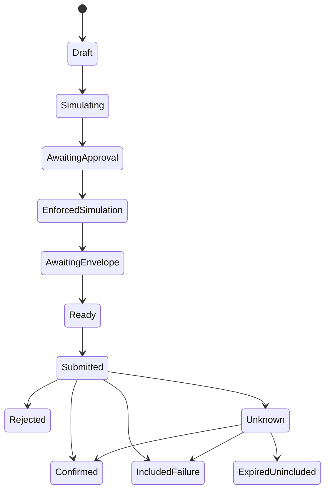

# Target clients, SDK and service contracts

Status: proposed production specification, 2026-11-05. There is no checked-in web
application, public SDK, database, API server, indexer or managed relay/keeper.
Current usage is [Python/native tooling](QASSET_POC_EVIDENCE.md). This document
implements the boundaries in the [primary architecture](ARCHITECTURE.md); API
names below are design examples, not importable packages or deployed endpoints.

## dApp architecture and journeys

Use a typed browser application with separate route/view, domain validation,
wallet capability, transaction and data-access modules. Select/pin framework and
build system when implementation begins; no existing frontend constrains them.
Static assets carry a build identifier and pinned dependency lock. Browser code
loads an approved network/release manifest, never contract IDs from metadata.

| Journey | Steps and validation | Recovery behavior |
| --- | --- | --- |
| Inspect asset | Choose network; enter exact issuer/code or token ID; derive/compare SAC; show coverage and evidence range | Cached view is labelled historical; unsupported identities stay inspectable without protection claims |
| Compare policy | Show declaration, observed authority and unknown edges separately; export raw inputs and verifier version | Provider disagreement or partial graph prevents fresh result |
| Edit declaration | Prove tenant authority; load revision; validate bounded quorum; show diff; use guarded setter | Conflict refetches and asks for new approval; never silently overwrites |
| Change holder authorization | Verify deployed SAC/admin/key; select holder and boolean; show residual issuer authority; prepare/sign/confirm | Missing trustline or incompatible flags reported before approval; final state rechecked |
| Transfer treasury asset, future controller | Show token/decimals, exact amount, destination, current policy, nonce, balances/allowances and fees | Pending outcome resumed from journal; no automatic duplicate transfer |
| Rotate authority, future controller | Show outgoing/incoming policy and epoch; obtain required consent/possession; test new key | Failed transition preserves old policy; require independently reviewed migration |
| Recovery | Disabled until cryptography, lifecycle and resource acceptance | No seed prompt or public scalar upload in released UI |

Keep remote queries keyed by network ID, deployment generation, contract/asset,
ABI and requested ledger. Do not share cache keys across environments. One
transaction state machine owns each operation. Local form state, wallet session
and query cache are separate; a successful simulation cannot mutate the confirmed
balance cache. Refresh on included result, ledger change or detected configuration
drift. Invalidate approvals on account/network/manifest/epoch change.

Persist only public intent digest, network/generation, transaction hashes, bounds,
status and operation ID in browser storage. A server-side encrypted journal may
retain signed XDR until resolution/retention expiry; do not put it in analytics,
URLs or error logs. Pending signed approvals are sensitive capabilities even
though they may eventually become public. Resume by querying outcomes after
reload; disconnect/cancel of UI does not revoke a submitted or signed credential.

Forms reject malformed/checksum-invalid addresses, unsupported variants or address
roles, noninteger epochs/weights and ambiguous decimal input. Validate again at
SDK/service boundaries. Display checksummed full destination on confirmation;
never rely on ticker, short address or logo. Ledger observation age, verified
scope and provider gap are text, not just colors. Status changes use accessible
live regions; modals manage focus, controls have keyboard labels, errors attach
to fields, and graph information has a tabular equivalent. Test contrast, zoom,
reduced motion, keyboard-only use and screen readers before release.

## Wallet and signer capabilities

Negotiate capabilities independently: network/account selection, envelope
signing, non-source Soroban auth signing, custom-account credential encoding,
ML-DSA parameter/context support, hardware/custody policy display and delegated
credential support. Classic wallet connectivity does not establish PQ capability.

[Freighter signing APIs](https://docs.freighter.app/extension-freighter-api/signing.md)
distinguish `signTransaction` from `signAuthEntry`; neither is a guarantee that an
extension signs ML-DSA credentials. Use a compatible external/native/custody
adapter for the protected operator key. Do not import a real seed into the dApp
or substitute an Ed25519 signature for the custom account's expected bytes.
`signMessage`/web login is separate from transaction consent.

A signing request must show the actual network, authorizing address/key, complete
authorized function/argument tree, nonce/expiry, purpose and policy epoch. A
wallet returning a different signer/network must fail locally. Source envelope
signing occurs after assembly; fee-bump signing approves a separate outer envelope.
The operator approval does not normally bind the relay's fee/sequence, so the
relay's own budget policy is mandatory.

The current native signer validates file permissions and exact digest length but
signs a supplied digest without parsing intent. It is a prototype utility, not a
policy-enforcing custody service. Target signer receives canonical intent plus
exact XDR/preimage, independently validates manifest/key/tree/arguments/expiry,
recomputes the digest and refuses unknown types. No API caller may supply both
an arbitrary digest and a claim that it passed policy validation.

## SDK package boundaries

Proposed logical modules (publication names and exact dependencies unresolved):

| Module | Public responsibility | Exclusions |
| --- | --- | --- |
| `core` | Asset/network identity, exact amounts, typed intents, canonical evidence codecs | Network or secret-key side effects |
| `bindings` | Generated clients/events/errors from pinned Wasm spec | Hand-edited ABI guesses |
| `network` | Manifest/protocol checks, RPC/Horizon transports, deadlines and cancellation | Automatic network fallback with different identity |
| `transactions` | Simulation, approved auth preservation, assembly, delivery/status and recovery | Silent re-sign/rebuild after ambiguous outcomes |
| `wallets` | Explicit envelope/auth/PQ adapter interfaces | Universal wallet capability assumptions |
| `assessments` | Schema validation, source/artifact hashes, classifications and freshness | Treating self-signed JSON as a security certificate |
| Native tools, separate distribution | Unix key file and public verification utility | Browser bundle, default secret logging or research prover dependencies |

Generate bindings from reviewed release Wasm with a pinned compatible Stellar CLI;
record generator version, spec/Wasm hash and generated-source checksum. Regenerate
and diff during release. Publish explicit supported contract hash/ABI, network
protocol, credential variants and underlying SDK versions. Reject unknown major
schemas/variants; preserve error code plus contract identity because codes overlap.
Package exports are explicit, with browser and server entry points, declaration
files, source maps reviewed for secrets, notices and no fixture seeds/private logs.
Run examples against the packed artifact in an empty consumer, not local source aliases.

The official [JavaScript SDK](https://github.com/stellar/js-stellar-sdk) supplies
RPC, XDR and assembly primitives, not Q-Asset authority models. Its
[authorization guide](https://stellar.github.io/js-stellar-sdk/guides/07-contract-auth/)
explains source/non-source signing and variant-aware preimage helpers. Pin and
qualify a release rather than copying a manual legacy payload constructor into
new production code.

### Proposed public interface examples

These are pseudocode contracts; a package and runnable examples must be supplied
and validated before SDK publication.

```typescript
// Amount and revision fields cross JSON boundaries as canonical integer strings.
type BaseUnits = string;
type PolicyRevision = string;
type NetworkRef = { networkId: string; generation: string };
type Intent = {
  network: NetworkRef; controller: string; token: string;
  action: "transfer"; destination: string; amount: BaseUnits;
  expectedEpoch: string; nonce: string; expiresLedger: number;
};
interface ApprovalSigner {
  authorize(request: { authorizer: string; preimageXdr: string;
    intent: Intent; context: string }): Promise<{ signatureScValXdr: string }>;
}
interface PreparedOperation {
  operationId: string; intentHash: string; approvedAuthHash: string;
  simulationLedger: number; maxFeeStroops: string;
  // Immutable, validated data; obtain envelope signature only after assembly.
}
```

Proposed flow: `validateManifest -> parseAmount -> prepare -> approve ->
validateAndSimulateAuth -> assemble -> signEnvelope -> journal -> submit ->
reconcile`. Functions return typed discriminated errors, never success-shaped
objects on errors. `parseAmount("1.0000001", 7)` yields base units `"10000001"`;
`"1.00000001"`, negative, `NaN` and exponent notation reject. `u64` revisions
and `i128` amounts must not pass through JavaScript `number`. Fees are exact
stroop integers too. `u32` ledger values are range checked. No hidden rounding.

Error families: `UnsupportedNetworkOrProtocol`, `ManifestMismatch`,
`UnsupportedAddressOrCredential`, `InvalidAmount`, `UnsupportedAsset`,
`WalletUnavailable`, `UserRejected`, `WrongSigner`, `AuthorizationRejected`,
`RevisionConflict`, `SimulationFailed`, `ResourceLimit`, `StorageRestoreRequired`,
`FeeBudgetExceeded`, `SubmissionRejected`, `IncludedFailure`, `Expired`,
`OutcomeUnknown`, `EvidenceInvalid`, `EvidenceStale`, `EvidenceUnavailable`.
Preserve raw provider/contract diagnostic codes for restricted debugging with
redaction; show actionable user text and retry eligibility separately.

## Transaction state machine



Pre-submission validation/rejection returns to a reviewable draft or terminal
cancelled state. The diagram omits those edges for readability. `Confirmed`
requires included success, correct decoded return and expected effects, not only
an RPC status string. If result succeeds but effects disagree, quarantine as an
incident. `Rejected` means a definitive pre-inclusion response; `IncludedFailure`
means a ledger receipt with failure and possibly charged fees/source sequence
consumption. Decode those effects; do not blindly reuse a sequence.

`Unknown` persists across network errors, poll timeouts and provider pruning.
[getTransaction](https://developers.stellar.org/docs/data/apis/rpc/api-reference/methods/getTransaction)
returns `SUCCESS`, `FAILED`, or `NOT_FOUND` within its available history. An empty
lookup is not evidence of nonexecution. Retain original XDR, auth expirations,
time bounds, source sequence, fee-bump inner/outer hashes and submission attempts.
Lookup both hashes and configured historical sources; compare source sequence
and business intent receipt where supported. A passed validity window plus
complete ledger history proving absence permits `ExpiredUnincluded`; expiry
alone is insufficient to disprove earlier inclusion.

Use per-source durable sequence leases and serialize outstanding writes initially.
Do not hold database transactions open while waiting for wallets. Persist before
external submission; crash after send must resume lookup. Retry transient 429/5xx
and transport failures with jitter, bounded attempts and a deadline shorter than
validity. Identical-envelope resend is allowed; a different intent/nonce/sequence
requires reconciliation and fresh review. A new fee-bump wrapper has its own hash
and signature and must be tracked as the same inner intent. Revision conflict
requires reload/new approval, not auto-overwrite.

Resource estimates include actual credentials, footprint, restore list and
qualified headroom. On archive detection, use simulation's automatic restore
information or an explicit compatible restore transaction, confirm restoration,
then re-simulate and reapprove if signed content/validity changed. Browser
read simulations do not maintain TTL; only submitted state changes persist.

## Indexer necessity and ingestion

Durable indexing is required for historical monitoring, alerting and the complete
tenant catalog. The current finite JSON PoC does not need a service indexer.
Target ingestion uses RPC `getLedgers` metadata for complete transactions/effects
and `getEvents` for filtered convenience, plus Horizon classic configuration and
RPC state reconciliation. Pin protocol-aware XDR decoders. Preserve raw XDR;
provider JSON formatting is not a stable canonical schema.

Event record key is `(networkId, generation, txHash, operationIndex, eventIndex)`.
Use operation index `-1` for transaction-level events such as fees, with an
explicit `eventLayer` discriminator; operation events retain their actual index.
Keep ledger sequence/hash, transaction application order, contract ID, type,
raw topic/data XDR, decoder version and provider event ID as well. Treat provider
IDs/cursors as opaque; do not infer universal IDs by parsing them. Define
`eventIndex` as the position in the raw operation's event array before filtering,
so filters and decoder upgrades cannot renumber events. Reconcile overlapping
sources by raw event identity and bytes; disagreement quarantines the ledger.
Classify issuer-involved issuance/redemption separately from ordinary
nonissuer transfer conservation; preserve native and SAC effects without
double-counting mirrored events. Only committed successful effects enter projections. Diagnostic or failed-call
traces remain separate observations.

Ingest bounded complete ledger ranges from each manifest's deployment ledger.
Archive raw header/metadata/checksums first. Within one database transaction,
insert deduplicated effects, apply projections, append alerts/outbox and advance
checkpoint. Checkpoint comprises generation, last fully applied ledger/hash,
source/cursor and decoder/schema versions. Do not advance on a partially fetched
page/ledger or when a filter partition is incomplete. A crash replays idempotently.
Check header parent continuity where supplied; disagreement is corruption/provider
mismatch or reset, not an ordinary probabilistic reorg.

Suggested relational schema:

| Table | Key and essential fields |
| --- | --- |
| `network_generations` | Network ID + generation; passphrase hash, anchors, approved manifest |
| `ledgers` | Generation + sequence; header hash, parent, close time, raw blob hash, protocol |
| `events` | Event record key; ledger/order, contract, raw XDR, decoded type/version |
| `authority_snapshots` | Asset + generation + ledger + configuration hash; issuer/admin/code/epoch, dependencies and coverage |
| `declarations` | Registry + asset + revision; admin, role data, mutation ledger/tx/event |
| `assessments` | Canonical evidence hash; schema/tool/adapter IDs, scope, ledger range, status, dependency hashes |
| `operation_attempts` | Operation ID + attempt; intent hash, source/sequence, XDR location, inner/outer hashes, bounds and state |
| `checkpoints` / `jobs` / `outbox` | Source partition/schema; complete watermark; lease owner/expiry; deduplicated task/event IDs |

Use exact integer/decimal-string columns with range constraints for `u64`/`i128`;
no floating-point money. Classic unified-event emission and historical availability depend on provider
configuration. Qualify CAP-67 metadata/events or a supported raw ledger-change
decoder for native effects; absent native events cannot imply absence of issuer
activity. Older SAC event shapes remain protocol-sensitive. Raw blobs and checksums are immutable. Projections are
rebuildable and contain explicit schema/adapter versions.

### Gaps, replay and reconciliation

Monitor endpoint `oldestLedger`/`latestLedger` and effective retention. If the next
checkpoint is older than available history, stop freshness advancement and mark
the interval incomplete. Replay from a qualified archive/data lake containing
that generation's exact metadata. Data-lake-backed `getLedgers` is provider-specific;
it does not promise historical `getEvents`/`getTransaction`. If no source has the
interval, expose permanent history incompleteness. A current state snapshot can
restore a current view after reconciliation but cannot fabricate missed events,
prior rejection transcripts or an unbroken history claim.

Replay into versioned shadow projections, compare counts/configuration hashes
and invariant totals, then atomically switch read version. Decoders must preserve
unknown event bytes and block affected freshness instead of dropping events.
Reconcile issuer signers/thresholds/flags, SAC admin, executable/key bindings,
registry revision/roles and controller state periodically and after relevant
changes. The fixed admin/recovery contract has no key-change events; future
adapters must not assume a universal event vocabulary.

Database migrations are ordered, checksummed and schema-versioned. Use
expand/backfill/validate/switch/contract; keep prior readers until cutover.
Backup before destructive migrations and test restore against a copy. Changing
an event decoder requires raw-data replay, not editing old attestations in place.
Retention duration and archive availability need assigned owners and budget;
keep public release evidence durable beyond routine RPC windows.

## API and backend boundaries

Proposed versioned read APIs:

```text
GET /v1/networks/{generation}/assets/{identity}/authority
GET /v1/networks/{generation}/assets/{identity}/assessments?cursor=...
GET /v1/assessments/{evidenceHash}
GET /v1/operations/{operationId}
GET /v1/health
```

Every response carries network/generation, schema/adapter/build version,
`indexedThroughLedger`, `reconciledAtLedger`, source tip, observation range,
gap/unknown reasons and freshness state. Never return HTTP200 success data with
a hidden exception. Invalid evidence is a validation error, changed configuration
is stale, provider outage is unavailable; preserve these distinctions. Lists use
opaque stable cursors keyed to a projection version; reset invalidates cursors.
Serve immutable artifacts by hash with checksums/ETags. Private annotations need
separate authenticated tenant APIs and cache controls.

Optional mutation APIs prepare/sponsor validated transactions, not approve them.
An idempotency key is scoped to authenticated tenant, generation and intent hash;
same key/different body rejects. Intent/action bytes and target nonce consumption
supply economic duplicate protection. Current direct SAC methods do not supply
that guarantee, so expose manual reconciliation for ambiguous calls.

API rate limits, query/graph bounds, blob size caps and per-tenant queues limit
abuse. Worker roles: ingestion, assessment/reconciliation, notifications/outbox,
TTL maintenance and optional relay. Use bounded concurrency, expiring DB leases
and idempotent task keys; lease ownership is not authorization. Serialize funded
source sequences, isolate approval signers and enforce fee/funding quotas.
Maintenance only extends/restores known dependencies; it cannot rotate keys,
lock issuers or rewrite declarations. Notifications never contain secret material
or confer authority. Actual hosting, login, alert destinations and on-call roles
remain unimplemented deployment requirements.
