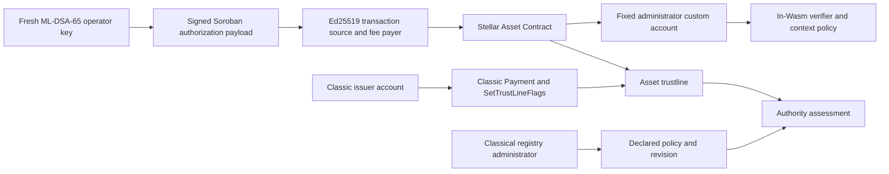

# SAC authority demonstration architecture

Recorded 2026-10-25. Deployment results are in
[`deployments/testnet/qasset-poc.json`](../deployments/testnet/qasset-poc.json).
The approved fresh run completed the restricted-issuer branch. The earlier
unlocked run is preserved under `deployments/testnet/history/` and `evidence/history/`.

## Authority layers

`QAssetSacAdmin` fixes one SAC address and one 1,952-byte public key at
construction. Its custom-account `__check_auth` accepts exactly one contract
authorization context: the configured SAC's `set_authorized` with two
arguments. The host commits those arguments, the invocation tree, network,
nonce and expiry into the signed authorization payload. The contract verifies
a 3,309-byte ML-DSA-65 signature with domain context
`qasset-sac-admin-auth-v1`.

ML-DSA-65 verification runs inside Wasm using unaudited RustCrypto `ml-dsa`
0.1.1. It does not use a CAP-87 host function. Testnet reported protocol 29
during deployment and evidence collection. Transaction and fee-bump envelope
signatures remain Ed25519.

## Integration decision

Option A makes the custom account the SAC administrator. The SAC's own
`require_auth` reaches the custom account, which can inspect and refuse the
complete authorization context. Option B, a wrapper that calls SAC methods,
would introduce a separate entry-point authority surface and direct-invoker
authorization concerns. This demonstration implements Option A.

The administrator has no outgoing SAC calls, upgrade, key rotation or recovery
entry point. It refuses `mint`, `clawback`, `set_admin`, another SAC, contract
creation and composite authorization contexts. A relay can submit a credential
for exactly its signed operation; the submitter is not an additional authority.
Only `set_authorized` is admitted. Local tests cover both authorization and
deauthorization; the live positive exercises authorization.

Successful authentication renews instance storage to 120,960 ledgers, capped
by the network maximum, when below half that target. This is approximately
seven days at five seconds per ledger. Lease maintenance and key availability
are operational requirements; this contract supplies no recovery mechanism.

## Assets and declarations

Both disposable issuers enable `AUTH_REQUIRED` and `AUTH_REVOCABLE`. Each
asset receives its own SAC and custom administrator; both administrators use
the run's fresh operator key. The separate classic issuer path remains until
that issuer's signing authority is retired.

QEXP demonstrates that residual path with successful classic Payment and
SetTrustLineFlags transactions after SAC handover. QCTL's issuer was generated
in a new run and then locked with explicit approval and
`QASSET_ALLOW_DISPOSABLE_ISSUER_LOCK=YES`. Its remaining master weight is zero,
and it has no positive-weight signer. Its classic Payment was rejected before
inclusion with `txBAD_AUTH`; a subsequent ML-DSA `set_authorized` transaction
succeeded. QEXP retains its classical signing weight.

The fresh registry stores three declarations per SAC: Freeze names the
ML-DSA administrator; Mint and Clawback name the classic issuer as Ed25519.
All use threshold one and weight one. These declarations do not authorize
SAC operations or prove enforcement. `policy_assessment` remains `Unverified`.

## Evidence flow

The runner records public transaction envelopes, receipts and explicitly
enforced negative simulations. The analyzer reads live Horizon issuer state,
contract instances and code, administrator getters and registry quorums.
It hashes the deployment, snapshot, Wasm files and selected sources, and
writes 32 authority-path classifications with citations and tool version/source identity.

The separate verifier imports no analyzer code. It checks input hashes,
raw XDR against decoded fields, executable bytes, invocation identities,
citations and independently derived classifications. Online mode also
rechecks transactions and live authority. A policy revision change returns
`STALE` for the affected asset's paths and a nonzero exit code. Offline
mode checks consistency only. Neither mode turns recorded simulation
transcripts into signed historical attestations.

The live staleness experiment repeated QEXP's same Freeze declaration on the
new registry. Revision 3 became 4, and the separate verifier marked QEXP's
16 paths `STALE` and exited 1. The primary assessment was then recollected at
QEXP revision 4 and QCTL revision 3. The preserved revision-3 assessment still
demonstrates staleness against live state. The verifier also checks that the
post-lock success follows the lock in ledger application order and cites both
the original and post-lock authorization transactions.

## Remediation release

All PoC declarations use `set_role_quorum_if_revision`, which checks the current
revision inside the same contract invocation and rejects stale writers with error
15. Failed guarded writes change neither policy nor emitted contract events.
The legacy unconditional setter remains for existing callers. Historical
registry instances and their evidence remain intact.

The verifier separately checks actual ML-DSA credential validity, the specific
wrong-network and corrupted mutations, exact consumed replay entries and raw
contract error diagnostics. It verifies the issuer signature and post-lock
interval for the rejected classic Payment. Schema v2 includes issuer configuration,
addresses, mechanism, tool version and source hashes. Raw response ledgers must
fit the declared interval. Generator time is not independently attested.

Live authority changes produce structured STALE paths. Unavailable required live
evidence produces INCONCLUSIVE and no freshness claim. Archived historical inputs
are resolved by content hash; current builds are reproduced with locked Cargo and
hash-pinned Python dependencies using `scripts/reproduce_poc.py`.
