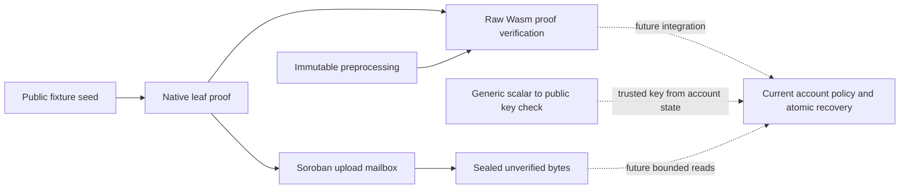

# Recovery implementation and remaining gates

Updated 2026-10-20. This is first-party, AI-assisted engineering evidence. No
external cryptographic approval or production recovery deployment is claimed.

## Current scope

Q-Asset retains its protect / assess / recover vision for Stellar asset
**authority**. The registry currently analyzes declared weighted policies. The
counter demonstrates previously enrolled ML-DSA backup recovery with a restricted
authorization surface. Original-seed recovery remains a conditional research
extension; its account contract still rejects all authorizations.

The research pipeline now has separate, testable components:

These boxes are separate experiments, not a deployed account workflow. In
particular, sealing an upload neither validates a proof nor changes authority.

## Findings and present disposition

| Finding | Correction or remaining gate |
| --- | --- |
| Target-width-dependent Fiat-Shamir sampler index | Fixed in the verifier fork with explicit native64-compatible u64LE encoding; original proof and transcript vector pass native/Wasm. |
| Duplicate unpadded and padded constraint vectors | Successor loader moves the constraint vector into exact padding and retains explicit metadata; complete constraint identity preserved. |
| Oversized preprocessing encoding | Exact original artifact transcodes to canonical compact ULEB32 wire encoding; strict decoding and immutable hash pin retained. |
| Oversized raw executable | Successor uses size profiles, external input and equivalent table-free inversion; complete raw module now fits the refreshed byte cap. Actual SDK ABI size is checked separately. |
| Fixture-only scalar/key relation | A separate generic no_std component checks strict clamping, canonical nonidentity prime-subgroup encoding and exact point equality. The expected key must come from trusted account state. |
| Python optimized mode could disable evidence assertions | New binding tools use explicit checks. Negative source/fixture/duplicate-case checks also reject under `python -O`. |
| Unmeasured Soroban execution | Actual SDK ABI diagnostics now exhaust the refreshed 400M instruction budget. This is failed execution, not cryptographic rejection; successful metered verification remains open. |
| Complete recovery lifecycle | Open: prior enrollment, trusted current key, revocation, epoch/expiry, replacement possession, cached authorization behavior and atomic one-time state transition need one reviewed integration. |
| Quantum knowledge and zero knowledge | Open: exact pinned backend, compilation assumptions and concrete complete parameters need independent review. The 96-bit query budget alone is not an overall/PQ security claim. |

See [successor verifier evidence](VERIFIER_NEXT_EVIDENCE.md),
[key-binding component](../tools/recovery-key-binding/README.md),
[transport evidence](PROOF_MAILBOX_EVIDENCE.md) and
[security argument](RECOVERY_SECURITY_ARGUMENT.md).

## Generic point binding boundary

For leaf seed `k`, let `a = clamp(SHA512(k)[0:32])` in little endian and `A=[a]B`.
The new binding component checks this last public relation with the **full
clamped scalar**, without silently repairing invalid clamp bits or accepting a
reduced scalar representation. It rejects noncanonical aliases, identity,
small-order and mixed-order keys. Its point arithmetic comes from pinned,
unmodified curve25519-dalek 4.1.3; no new curve scheme is invented.

This is mathematical validation only. A claimant-selected public key does not
establish account ownership. The integrating account must independently select
its protected key and current recovery policy, and bind the same scalar to the
proof and exact recovery action. Point validity is not seed knowledge.

The raw and SDK proof fixtures continue to pin the published RFC8032 identity;
they do not silently become generic account recovery by importing this helper.
All witnesses and keys in these experiments are public fixtures and must never
hold funds.

## Authority retirement and activation

The scalar is a functioning classical signing secret. Every effective classical
or reused-key authority must be retired with finality **before** its disclosure,
including to RPC, fee payer or any untrusted service. Public retire-and-reveal in
one transaction does not protect the prepublication interval. Recovery cannot
retroactively rescue an unenrolled classic account or undo legitimate revocation.

A successful backend milestone needs complete accepted proof execution within
network limits, supported transport and immutable preprocessing, current-policy
and replacement checks, atomic consumption, adverse-input bounds and independent
cryptographic/implementation review. A code-size pass or a resource no-go result
cannot substitute for a complete production-recovery implementation. Completed
experiments remain evidence within their documented scope.
